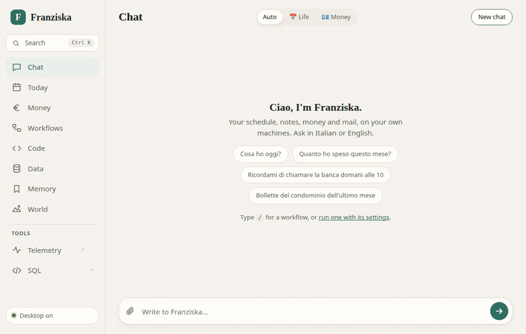
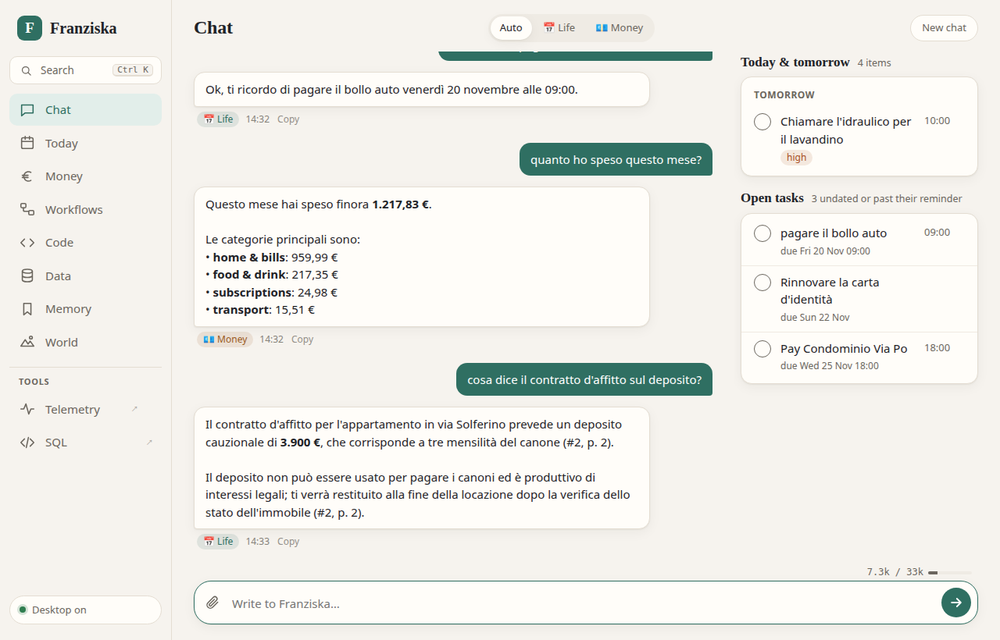
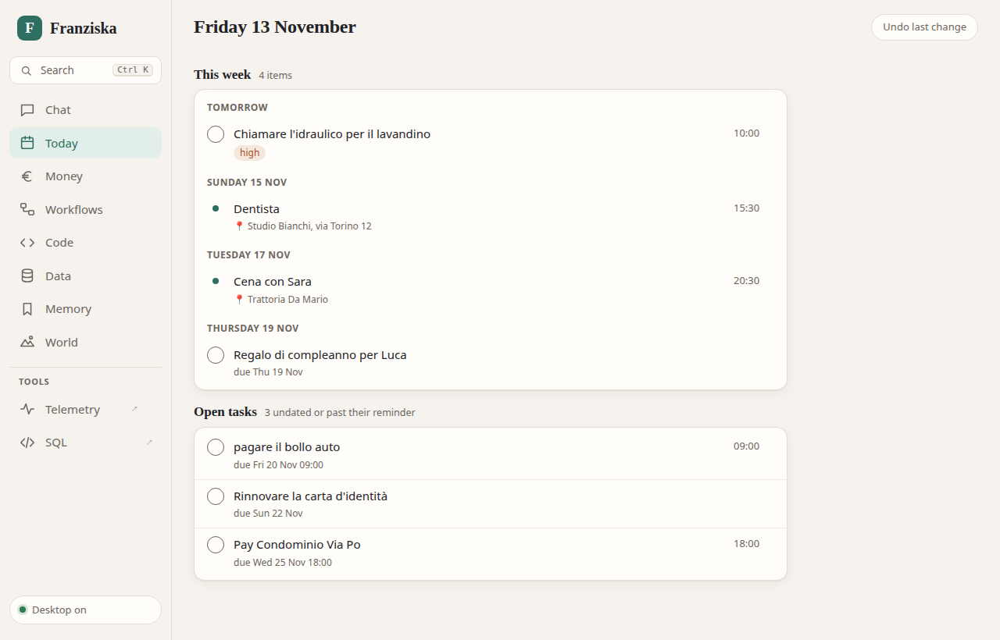
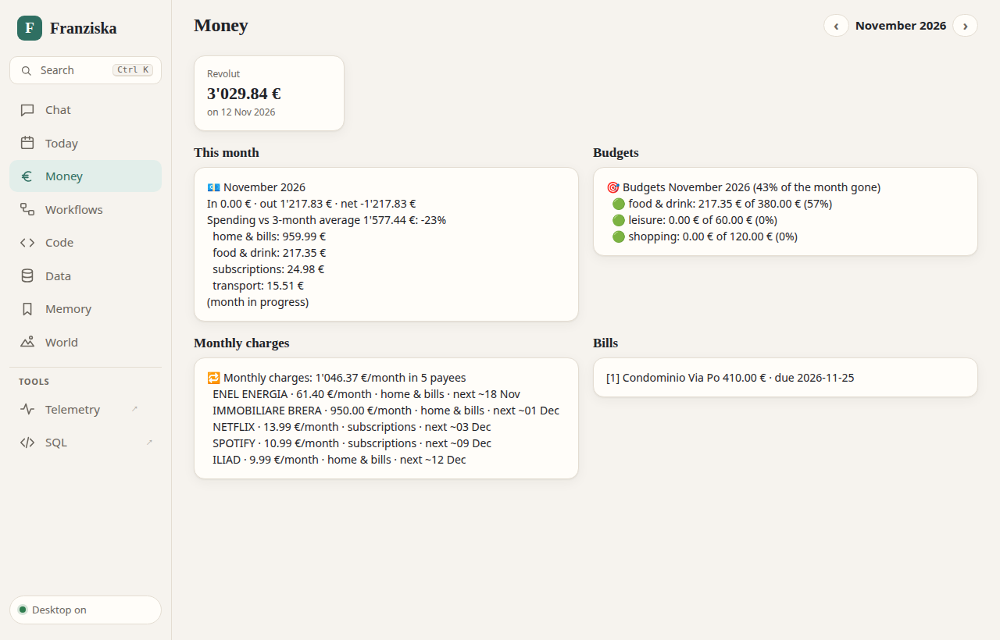
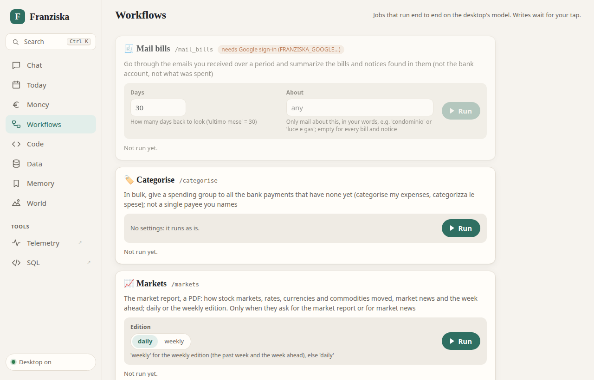
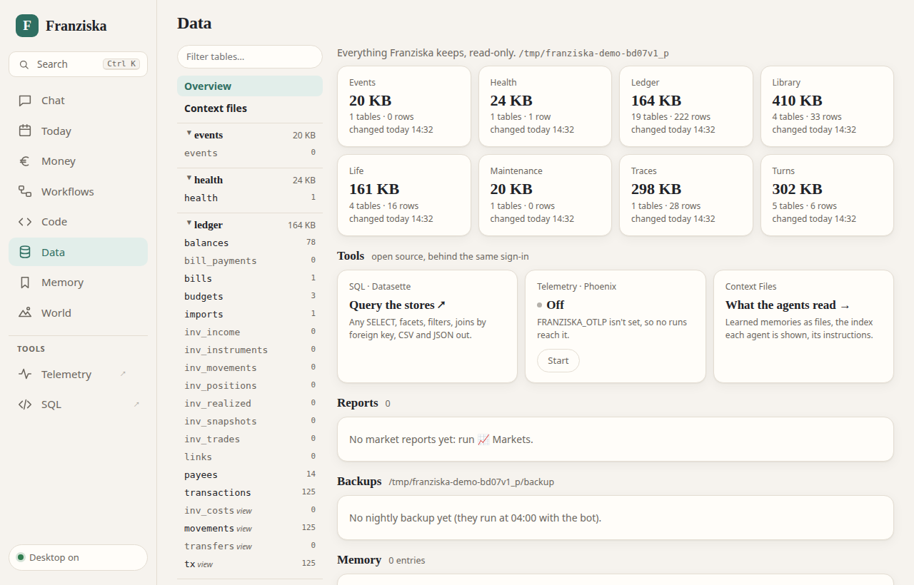
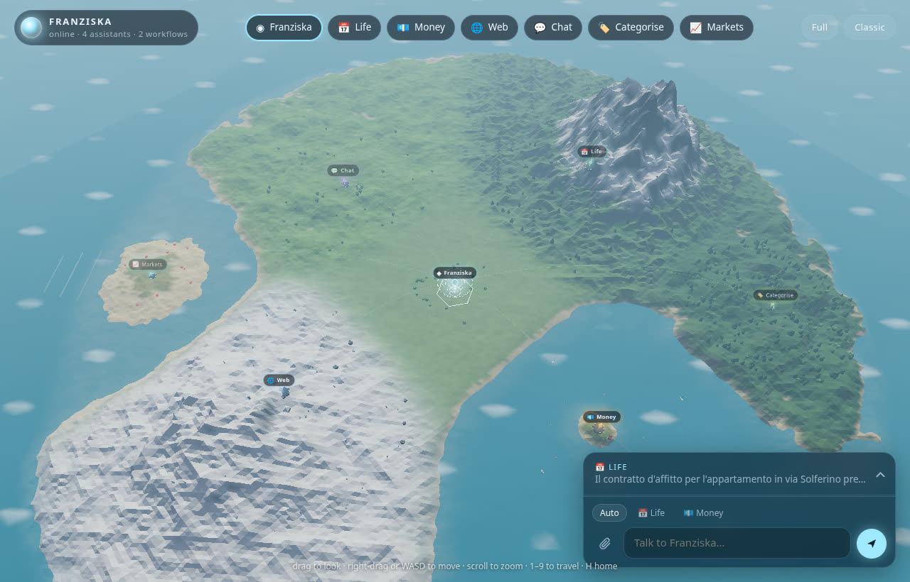
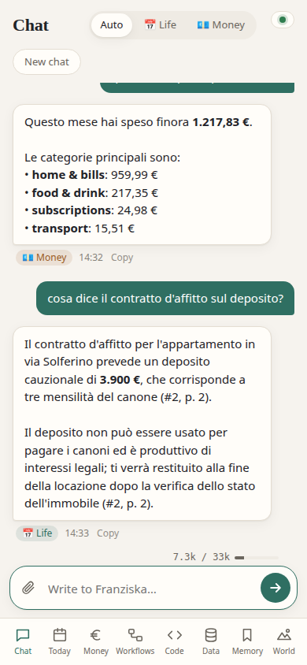
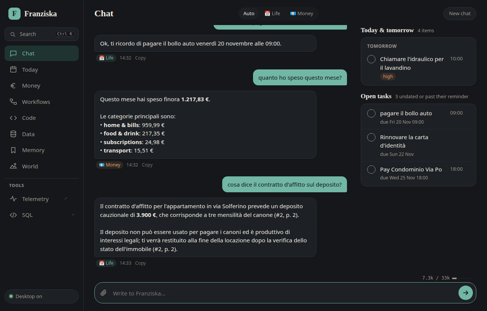

# Franziska

**A personal assistant for the admin of your life (schedule, money, mail, documents) that runs on your own GPU.
Your bank data and your mail never leave the machine, because of how it's built, not because of a setting.**

You talk to it on Telegram or in its web app, in Italian or English. A local model routes each message to the right
assistant in about a second and a half; the assistants act through typed tools over local stores; and everything
that can be computed in code (reminders, budgets, bill matching, spending summaries) is, so the model never has to be
trusted with a number.

<p align="center">
  
  <br><sub>The demo on gemma-4-26B with a made-up person's data. The model's thinking time is sped up.</sub>
</p>


## What it does

| | |
|---|---|
| 📅 **Life** | Appointments, tasks, reminders with ✅ Done / +1h / Tomorrow buttons, recurring items, notes, a memory of what you told it, and a library of every document you sent, searchable by words and meaning |
| 💶 **Money** | Imports your bank's export (any bank: see below), groups spending, budgets, finds subscriptions and price changes, tracks bills that become reminders and tick themselves off when the bank shows them paid, a DEGIRO portfolio |
| ✉️ **Mail** | Gmail triage on the local model (what needs you, pushed to the chat), an agent that searches, reads and drafts but never sends, and a workflow that finds bills in your inbox |
| 🌐 🖥 💬 | Web search through your own SearXNG; questions about this computer and coding jobs in a sandbox; plain chat |
| ⏰ **On its own** | A morning brief, an evening check-in, a Sunday review, a monthly money summary, a market report PDF on weekdays |
| 🔌 **Everywhere** | An installable web app, voice notes transcribed on your CPU, and an MCP server so Claude Code, Codex or pi can read your schedule (never your money) |

**Any bank.** Send an export it doesn't know: it finds the header and the columns, the local model decides what each
column holds, code reads every row and checks the running balance, and you get a preview with an ✅ Import button.
The format is saved, and the next file from that bank is imported by code alone. Intesa Sanpaolo and Revolut are
built in; DEGIRO for investments.

## The web app

| | |
|---|---|
|  |  |
| **Chat**: one box for everything; each reply says which assistant answered, and today's list sits beside it | **Today**: the week from your tasks and calendar, ticked off with a tap; Undo takes back the last change |
|  |  |
| **Money**: balances, the month against your average, budgets, monthly charges and bills | **Workflows**: jobs that run end to end, each with its own form; what they would write waits for your tap |
|  |  |
| **Data**: every store, read-only, with SQL (Datasette) and telemetry (Phoenix) one click away | **World**: the same chat in a 3D landscape, one place per assistant |

**Memory** shows what it learned about you and each assistant's rules, which you can edit; **Code** follows the coding
jobs; **Setup** and **Settings** change the configuration from the page; Ctrl K searches all of it. It installs as an
app on the phone, and follows the system's dark mode.

<p align="center">
  &nbsp;&nbsp;
  
</p>

## Why it's different

Most personal agents are general: a cloud model, a shell, and a marketplace of skills. Franziska goes the other way.

| | General-purpose agents | Franziska |
|---|---|---|
| Model | a cloud API key | one local model on a 12 GB GPU; cloud models are opt-in, per route |
| Privacy | depends on configuration | a table in code decides who sees what (`privacy.py`); money and mail never reach a cloud model |
| Extensions | third-party skills | everything is in this repo, and each assistant has a data class in the privacy table |
| Untrusted text | read by the agent that acts | a run that read an email, document or page can only *propose* writes, as buttons |
| Running code | a shell | a bubblewrap sandbox: no network, no `$HOME`, no secrets |
| Numbers | whatever the model says | a money reply with figures is rejected unless a tool returned them |
| Decisions | generated text, parsed | AnyJev: the model's next-token probabilities over typed options, with "ask me" below a threshold |
| Measured | demos | evals on the real model: a simulated week, router accuracy per model, a month of use (`evals/`) |

## Try it

```bash
git clone <this repo> franziska && cd franziska && uv sync
uv run python -m franziska demo      # the web app on a made-up person's data: http://127.0.0.1:8766
```

The demo needs nothing of yours. Its chat needs a local model (below); the agenda, money and documents work without.
It asks Ollama for `gemma4:12b`; with llama-server instead:

```bash
FRANZISKA_BASE_URL=http://localhost:8080/v1 FRANZISKA_MODEL=gemma4-26b-a4b uv run python -m franziska demo
```

Setup and Settings are off in the demo: they would change this machine's configuration, not the demo's.

## Set it up

```bash
uv run python -m franziska.web      # then open http://127.0.0.1:8765
```

The web app opens on **Setup**: one card per piece, each saying what it adds, whether it works, and how to turn it
on, from the page. It needs the language model and a time zone; everything else is optional. Without Google it keeps
appointments in its own calendar; without Telegram it is the web app alone (Telegram is how reminders and the morning
brief reach your phone). The page installs the services so Franziska starts at login, and restarts them when you
change something.

In a terminal instead: `python -m franziska init` asks the same questions, and
`uv run --env-file .env python -m franziska doctor` checks every piece (✅ / ⚠️ / ❌ with the fix).

**Needs:** Linux, Python 3.12 and [uv](https://docs.astral.sh/uv/), a local model server. Measured on an RTX 3060
(12 GB) with gemma-4-26B-A4B on llama.cpp (`deploy/franziska-llm.service`); with less VRAM, Ollama and `gemma4:12b`.
Setup suggests one from your GPU. Always-on setups (a small box that wakes the GPU desktop when a message needs it)
are in `deploy/BOX.md`.

**Optional:** Telegram (a bot token), Google Calendar and Gmail (a Google Cloud app of your own: Google requires one
for Gmail access, Setup walks you through it), the mail agent ([gogcli](https://github.com/openclaw/gogcli), the same
Google app), SearXNG, an embedding server for search by meaning, voice notes, the market report, Claude on your own
subscription for the life and chat routes, a cloud model for chat. All in [`.env.example`](.env.example), each with
its comment.

## Use it from code

The web app is a plain HTTP API on the same port. From this machine it needs no sign-in; from anywhere else, set
`FRANZISKA_WEB_TOKEN` and open `/login?token=…` once.

```bash
curl -N http://127.0.0.1:8765/api/chat -H 'content-type: application/json' -d '{"text": "cosa ho domani?"}'
curl http://127.0.0.1:8765/api/today            # the week, open tasks, done today
curl "http://127.0.0.1:8765/api/money?month=2026-11"
```

A chat answer streams as NDJSON: `status` lines while it works, then one `reply` with the text, the assistant that
answered and its buttons.

```python
import json

import httpx

URL = "http://127.0.0.1:8765"

with httpx.stream("POST", f"{URL}/api/chat", json={"text": "cosa ho domani?"}, timeout=None) as r:
    for line in r.iter_lines():
        event = json.loads(line)
        if event["type"] == "status":
            print("…", event["text"])  # "Choosing an assistant…", "📅 Life · thinking…"
        elif event["type"] == "reply":
            print(event["label"], event["text"])
            for button in event["actions"]:  # proposals and choices: POST /api/action {"id": ...} taps one
                print("  [", button["label"], "]", button["id"])

today = httpx.get(f"{URL}/api/today").json()
print([item["title"] for item in today["week"]])
```

Every endpoint (workflows, tasks, memory, rules, data) is in [WEB.md](docs/WEB.md#3-api). For Claude Code, Codex or
pi, the MCP server is the better door: `python -m franziska.mcp_server` (the schedule, never the money).

## Numbers

- Routing: ~1.4 s a message over 7 routes on gemma-4-26B (llama-server, RTX 3060).
- A month of everyday use, simulated on a copy of real data (416 checked steps, ~400 messages): 357 passed on the
  first run.
- Market report: ~2.5 min on weekdays, with every figure checked against its source.
- A new bank's format: ~20 s once, then code only.

## Docs

| | |
|---|---|
| [ARCHITECTURE.md](docs/ARCHITECTURE.md) | start here: the pieces, the technologies, the life of a message, with diagrams |
| [GUIDE.md](docs/GUIDE.md) | the full manual: every assistant, job, command and setting |
| [COMMANDS.md](COMMANDS.md) | every Telegram command and CLI |
| [WEB.md](docs/WEB.md) | the web app and its HTTP API |
| [DESIGN.md](docs/DESIGN.md) | why: the numbered design decisions and what measurements decided them |
| [SECURITY.md](SECURITY.md) | the privacy model and its limits |
| [CONTRIBUTING.md](CONTRIBUTING.md) | adding a bank, a workflow or an assistant |
| [evals/](evals/README.md) | how it is measured |

## License

Apache-2.0. See [LICENSE](LICENSE).
