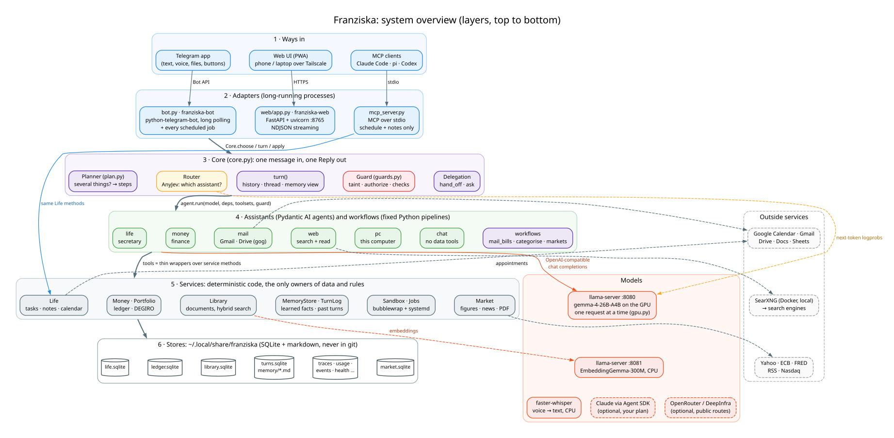

# Franziska

**A personal assistant for the admin of your life (schedule, money, mail, documents) that runs on your own GPU.
Your bank data and your mail never leave the machine, because of how it's built, not because of a setting.**

You talk to it on Telegram or in its web app, in Italian or English. A local model routes each message to the right
assistant in about a second and a half; the assistants act through typed tools over local stores; and everything
that can be computed in code (reminders, budgets, bill matching, spending summaries) is, so the model never has to be
trusted with a number.



## What it does

| | |
|---|---|
| 📅 **Life** | Appointments, tasks, reminders with ✅ Done / +1h / Tomorrow buttons, recurring items, notes, a memory of what you told it, and a library of every document you sent, searchable by words and meaning |
| 💶 **Money** | Imports your bank's export (any bank: see below), groups spending, budgets, finds subscriptions and price changes, tracks bills that become reminders and tick themselves off when the bank shows them paid, a DEGIRO portfolio |
| ✉️ **Mail** | Gmail triage on the local model (what needs you, pushed to the chat), an agent that searches, reads and drafts but never sends, and a workflow that finds bills in your inbox |
| 🌐 🖥 💬 | Web search through your own SearXNG; questions about this computer and coding jobs in a sandbox; plain chat |
| ⏰ **On its own** | A morning brief, an evening check-in, a Sunday review, a monthly money summary, a market report PDF on weekdays |
| 🔌 **Everywhere** | An installable web app, voice notes transcribed on your CPU, and an MCP server so Claude Code, Codex or pi can read your schedule (never your money) |

**Any bank.** Send an export it doesn't know: it finds the header and the columns, the local model decides what each
column holds, code reads every row and checks the running balance, and you get a preview with an ✅ Import button.
The format is saved, and the next file from that bank is imported by code alone. Intesa Sanpaolo and Revolut are
built in; DEGIRO for investments.

## Why it's different

Most personal agents are general: a cloud model, a shell, and a marketplace of skills. Franziska goes the other way.

| | General-purpose agents | Franziska |
|---|---|---|
| Model | a cloud API key | one local model on a 12 GB GPU; cloud models are opt-in, per route |
| Privacy | depends on configuration | a table in code decides who sees what (`privacy.py`); money and mail never reach a cloud model |
| Extensions | third-party skills | everything is in this repo, and each assistant has a data class in the privacy table |
| Untrusted text | read by the agent that acts | a run that read an email, document or page can only *propose* writes, as buttons |
| Running code | a shell | a bubblewrap sandbox: no network, no `$HOME`, no secrets |
| Numbers | whatever the model says | a money reply with figures is rejected unless a tool returned them |
| Decisions | generated text, parsed | AnyJev: the model's next-token probabilities over typed options, with "ask me" below a threshold |
| Measured | demos | evals on the real model: a simulated week, router accuracy per model, a month of use (`evals/`) |

## Try it

```bash
git clone <this repo> franziska && cd franziska && uv sync
uv run python -m franziska demo      # the web app on a made-up person's data: http://127.0.0.1:8766
```

The demo needs nothing of yours. Its chat needs a local model (below); the agenda, money and documents work without.

## Set it up

```bash
uv run python -m franziska init                        # asks a few questions, writes ~/.config/franziska/.env
uv run python -m franziska.sandbox bootstrap           # the isolated runtime for run_python
uv run --env-file .env python -m franziska doctor      # every piece: ✅ / ⚠️ / ❌ with the fix
uv run --env-file .env python -m franziska.bot         # Telegram; send /whoami, put your id in the config
uv run --env-file .env python -m franziska.web         # the web app on 127.0.0.1:8765
```

**Needs:** Linux, Python 3.12 and [uv](https://docs.astral.sh/uv/), a local model server. Measured on an RTX 3060
(12 GB) with gemma-4-26B-A4B on llama.cpp (`deploy/franziska-llm.service`); with less VRAM, Ollama and `gemma4:12b`.
`init` picks one from your GPU. Always-on setups (a small box that wakes the GPU desktop when a message needs it) are
in `deploy/BOX.md`.

**Optional, each one setting:** Telegram (a bot token), Google Calendar and Gmail (your own OAuth client), the mail
agent ([gogcli](https://github.com/openclaw/gogcli)), SearXNG, an embedding server for search by meaning, voice notes,
the market report, Claude on your own subscription for the life and chat routes, a cloud model for chat. All in
[`.env.example`](.env.example), each with its comment.

## Numbers

- Routing: ~1.4 s a message over 7 routes on gemma-4-26B (llama-server, RTX 3060).
- A month of everyday use, simulated on a copy of real data (416 checked steps, ~400 messages): 357 passed on the
  first run.
- Market report: ~2.5 min on weekdays, with every figure checked against its source.
- A new bank's format: ~20 s once, then code only.

## Docs

| | |
|---|---|
| [ARCHITECTURE.md](docs/ARCHITECTURE.md) | start here: the pieces, the technologies, the life of a message, with diagrams |
| [GUIDE.md](docs/GUIDE.md) | the full manual: every assistant, job, command and setting |
| [COMMANDS.md](COMMANDS.md) | every Telegram command and CLI |
| [DESIGN.md](docs/DESIGN.md) | why: the numbered design decisions and what measurements decided them |
| [SECURITY.md](SECURITY.md) | the privacy model and its limits |
| [CONTRIBUTING.md](CONTRIBUTING.md) | adding a bank, a workflow or an assistant |
| [evals/](evals/README.md) | how it is measured |

## License

Apache-2.0. See [LICENSE](LICENSE).
