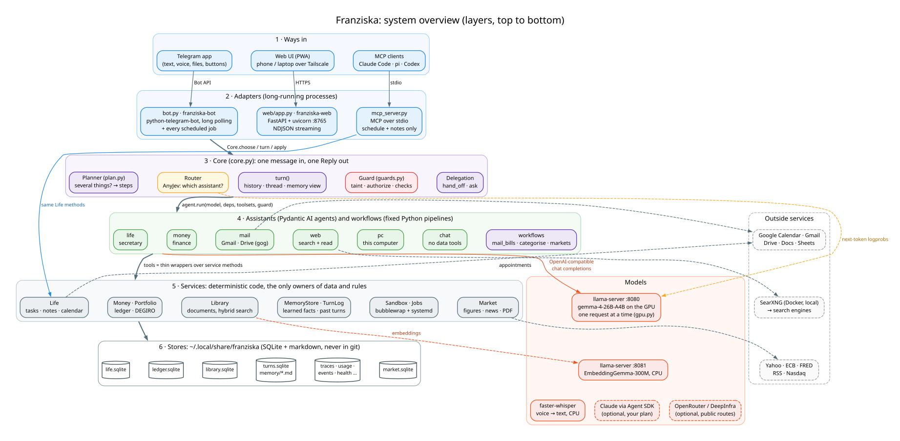
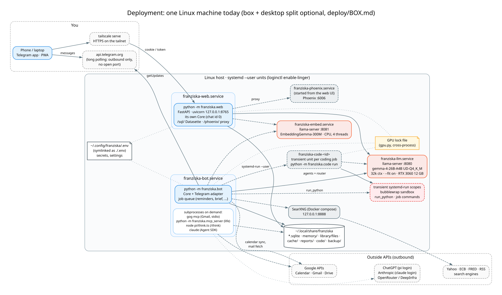
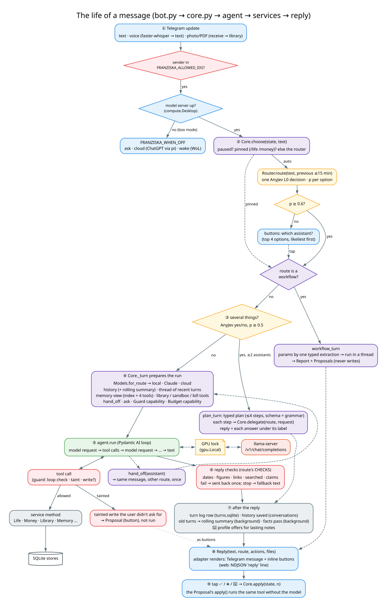
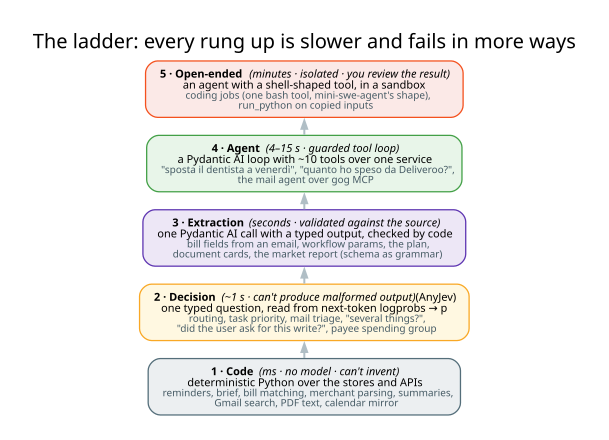
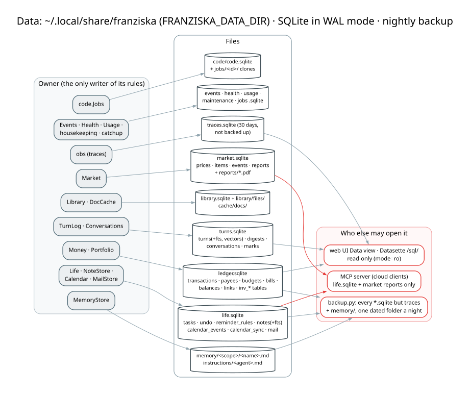

# Franziska: architecture guide

**Start here.** This is the map: what the system is made of, which technologies it uses, and how the pieces talk to
each other. Every section ends with a pointer to a deeper page. The other docs answer different questions:
`DESIGN.md` explains *why* each decision was taken (numbered decisions), `ROADMAP.md` covers what may come next,
and `COMMANDS.md` is the operator's cheat sheet.

The diagrams are Graphviz sources in [`docs/diagrams/`](diagrams/) (`*.dot`), rendered to SVG by
`docs/diagrams/render.sh`. Colours mean the same thing in every diagram:

| colour | meaning |
|---|---|
| blue | a way in: Telegram, the web UI, MCP, an adapter, a button |
| purple | core orchestration: routing, turns, planning, delegation, workflows |
| amber | an **AnyJev decision**: a classification read from the model's logprobs (no text generated) |
| green | an **LLM agent loop** (Pydantic AI) |
| grey | **deterministic code**: a service, a parser, a job |
| white cylinder | a store (SQLite or files) |
| orange | a model runtime (llama-server, Claude, a cloud model) |
| red | a guard or a privacy boundary |
| dashed | optional, or outside this machine |

---

## 1. What Franziska is

Franziska is a **local-first personal assistant**: one "voice" you write to on Telegram (or in an installable web
app). Behind it is a small team of specialist assistants:

| assistant | does | data it owns |
|---|---|---|
| 📅 **life** (secretary) | appointments, tasks, reminders, notes, your saved documents | `life.sqlite`, Google Calendar |
| 💶 **money** (finance) | bank imports, spending, budgets, bills, DEGIRO portfolio | `ledger.sqlite` |
| ✉️ **mail** | Gmail, Drive, Docs, Sheets: search, read, draft, organise | your Google account (via `gog`) |
| 🌐 **web** | search the internet, read pages | none (public data only) |
| 🖥 **pc** | this computer: disk, GPU, services, logs, files, coding jobs | none |
| 💬 **chat** | everything else: general knowledge, small talk | none |
| workflows | fixed pipelines: `mail_bills`, `categorise`, `markets` | they write through the services |

Four properties shape almost every design choice:

1. **Local first.** The language model (gemma-4-26B-A4B) runs on your own GPU through llama.cpp. Money and mail
   never leave the machine. Cloud models are optional and limited to routes that carry no personal data.
2. **Deterministic where possible.** Reminders, the brief, bank parsing, budgets and bill matching are plain
   Python. The model never computes a total.
3. **Small, typed model calls.** Routing and yes/no checks are *read* from next-token probabilities (AnyJev)
   instead of generated. Agents get about ten narrow tools each, not one big toolbox.
4. **The user confirms what automation proposes.** Writes that come from untrusted content (an email, a web page,
   a document) or from automation become buttons you tap.

## 2. The big picture

Read it top to bottom as six layers:

1. **Ways in.** The Telegram app, the web UI (a PWA reached over Tailscale) and MCP clients (Claude Code, pi,
   Codex).
2. **Adapters.** Three processes translate those channels: `bot.py` (Telegram), `web/app.py` (HTTP) and
   `mcp_server.py` (Model Context Protocol). The bot and the web UI share all their logic through `Core`. The MCP
   server exposes only the secretary's service.
3. **Core** (`core.py`). Channel-neutral: one message in, one `Reply` out. It picks the assistant (router), splits
   multi-part requests (planner), builds each agent run (history, memory, tools, guard) and turns proposed writes
   into buttons.
4. **Assistants and workflows.** Pydantic AI agents, one per domain, plus workflows (fixed Python pipelines that use
   the model only for small typed steps).
5. **Services.** The only owners of data and rules: `Life`, `Money`, `Portfolio`, `MemoryStore`, `TurnLog`,
   `Library`, `Market`, `Sandbox`. Every agent tool, `/command`, CLI and MCP tool is a thin wrapper over a service
   method, so a behaviour lives in exactly one place.
6. **Stores.** SQLite files and markdown in `~/.local/share/franziska`, outside the repository.

Beside the layers: the **models** (llama-server on the GPU for every agent and decision, a second llama-server on
the CPU for embeddings, faster-whisper for voice, and optionally Claude or a cloud model) and the **outside
services** (Google APIs, a local SearXNG, public market data).

## 3. Technology stack

What each technology is, why it is here, and where it lives in the code.

### Language, packaging, runtime

| technology | role here | where |
|---|---|---|
| **Python 3.12** + **uv** | the whole application; `uv sync` installs, `uv run` runs. No build system: an application, not a package | `pyproject.toml`, `uv.lock` |
| **systemd user units** | the always-on processes (`franziska-bot`, `-web`, `-llm`, `-embed`), transient units for coding jobs and sandboxed code | `deploy/*.service`, `sandbox.py`, `code.py` |
| **SQLite** (stdlib `sqlite3`, WAL, FTS5) | every store; WAL lets the bot, the web UI and the MCP server share files; FTS5 does word search | `db.py`, every `*store*`/`service` module |
| **Node.js 24** | runs pi for `/think` (ChatGPT) | `pi/think.ts` |
| **Docker compose** | SearXNG, the self-hosted metasearch engine | `deploy/searxng/` |
| **Tailscale** | private HTTPS to the web UI from phone and laptop (`tailscale serve`) | `deploy/franziska-web.service` |

### Models and inference

| technology | role here | where |
|---|---|---|
| **llama.cpp `llama-server`** (b11936, CUDA 12.8) | serves the one local model over an OpenAI-compatible API (`/v1/chat/completions`) and the raw `/completion` endpoint the router reads logprobs from | `deploy/franziska-llm.service` |
| **gemma-4-26B-A4B** (UD-Q4_K_M GGUF) | the local model for every agent, decision and extraction: a mixture-of-experts model; `--fit on` keeps the experts that don't fit in 12 GB VRAM in RAM (~38 tok/s on an RTX 3060), 32k context | `docs/MODEL_NOTES.md`, `MODEL_FINDINGS.md` |
| **EmbeddingGemma-300M** | sentence embeddings for documents and past turns, on the CPU in its own llama-server (:8081), so it never competes for the GPU | `deploy/franziska-embed.service`, `library.py` |
| **faster-whisper** (CTranslate2, `large-v3-turbo`, int8, CPU) | voice notes to text, on the machine | `voice.py` |
| **Ollama** | fallback runtime when `FRANZISKA_BASE_URL` is empty | `llm.py`, `jev_ollama.py` |
| **Claude Agent SDK** (`claude-agent-sdk`) | optional: runs some routes on Claude through *your* Claude Code login (subscription, not an API key) | `claude.py` |
| **OpenRouter / DeepInfra** | optional cloud model for public routes (chat, web, markets), zero-retention endpoints | `llm.py`, `usage.py` |
| **pi** (`@earendil-works/pi-coding-agent` 1.4.0) | `/think` and desktop-off turns on ChatGPT via "Sign in with ChatGPT"; tools limited to the `life` MCP server | `pi/think.ts`, `cloud.py` |

### Agent and decision libraries

| technology | role here | where |
|---|---|---|
| **Pydantic AI** (`pydantic-ai-slim` 2.61) | the agent loop: typed tools, typed outputs (`NativeOutput` uses the JSON schema as llama-server's grammar), toolsets, **capabilities** (the hooks the guard and the context budget plug into), MCP toolsets, `FallbackModel`, OpenTelemetry instrumentation | every `agent.py`, `core.py`, `guards.py`, `budget.py` |
| **AnyJev** (git pin `35311c5`) | "Jev" decisions: a typed multiple-choice or yes/no question answered by reading the next-token logprob of each option label, with the content-free prior divided out → a calibrated-ish probability, never malformed output | `router.py`, `jev_server.py`, `jev_ollama.py` |
| **MCP** (`mcp` 2.3, FastMCP) | the secretary's tools as an MCP server (stdio), and the mail agent's tools as MCP *clients* (`gog mcp`, `life`) | `mcp_server.py`, `mail/agent.py` |
| **llama-cpp-python** | loads a GGUF **vocabulary only** (no weights), so AnyJev can tokenize prompts exactly like the server does | `jev_server.py`, `export_vocab.py` |

### Channels, web, documents, data

| technology | role here | where |
|---|---|---|
| **python-telegram-bot** 22 (with job-queue / APScheduler) | Telegram long polling (no open port), inline buttons, all scheduled jobs | `bot.py`, `catchup.py` |
| **FastAPI** + **uvicorn** | the web UI's API; replies stream as NDJSON | `web/app.py` |
| **vanilla JS PWA** + **three.js** | the web app (no build step); `/world`, a 3D view of the team | `web/static/` |
| **Datasette** | read-only SQL browser over every store at `/sql/` | `web/tools.py` |
| **Phoenix** (Arize, optional) | LLM trace viewer at `/phoenix/` | `deploy/franziska-phoenix.service` |
| **OpenTelemetry SDK** | spans for every run, stored in `traces.sqlite`, optionally exported over OTLP | `obs.py` |
| **gog** (gogcli v0.47.1) | Google Workspace CLI with an MCP mode: typed Gmail/Drive/Docs/Sheets tools; sending disabled | `mail/agent.py` |
| **httpx** + own OAuth | Google Calendar and Gmail REST without the Google SDK | `google/` |
| **poppler** (`pdftotext`, `pdftoppm`) + **tesseract** (ita+eng) | PDF text and OCR on the CPU | `documents.py` |
| **openpyxl** | bank `.xlsx` exports, `.xlsx` documents | `finance/importer.py`, `documents.py` |
| **trafilatura** | main text of a web page | `search.py`, `market/sources.py` |
| **WeasyPrint** | HTML/CSS to the market report PDF | `market/pdf.py` |
| **numpy** (via the embeddings) | brute-force vector search: at personal scale it takes milliseconds | `library.py`, `turns.py` |
| **bubblewrap** + **systemd-run** | the sandbox: empty root and no network (bwrap), resource limits (cgroups through a transient unit) | `sandbox.py` |
| **git** | coding jobs: clone, bundle, fetch, review a branch | `code.py` |

## 4. Where it runs

Today everything runs on one Linux desktop with an RTX 3060 (12 GB). Four user units are always on:

| unit | process | port |
|---|---|---|
| `franziska-llm` | `llama-server` with gemma-4-26B-A4B on the GPU | 127.0.0.1:8080 |
| `franziska-embed` | `llama-server --embedding` with EmbeddingGemma-300M, CPU only | 127.0.0.1:8081 |
| `franziska-bot` | `python -m franziska.bot`: Telegram + every scheduled job | none (outbound polling) |
| `franziska-web` | `python -m franziska.web`: FastAPI | 127.0.0.1:8765 (`tailscale serve` for HTTPS) |

Started on demand: `franziska-phoenix` (from the web UI), `franziska-code-<id>` (one per coding job), transient
`systemd-run` units for sandboxed code, and SearXNG in Docker. The bot also spawns short-lived subprocesses:
`gog mcp` and `python -m franziska.mcp_server` for the mail agent, `node pi/think.ts` for `/think`, and the
`claude` CLI when a route runs on Claude.

The bot and the web UI each build their own `Core`. They share state only through the files in the data dir (the
stores, the `paused` flag, the GPU lock file), so either can restart without the other noticing.

**Optional box + desktop split** (`deploy/BOX.md`): a ~10 W always-on box runs the bot, the stores and every job
that needs no model, and wakes the desktop over Wake-on-LAN when a message needs the GPU. The router then works on
the box from a 16 MB vocabulary-only GGUF plus the desktop's logprobs. `FRANZISKA_WHEN_OFF` decides what happens
while the desktop sleeps (ask / ChatGPT now / wake and wait).

Deeper: [architecture/operations.md](architecture/operations.md).

## 5. The life of a message

Following one Telegram message, *"sposta il dentista a venerdì alle 10"*:

1. **Adapter.** `bot.on_text` gets the update. Only ids in `FRANZISKA_ALLOWED_IDS` are answered. A voice note is
   transcribed first, and a document goes through `Core.receive`. A bank export is imported directly; anything else
   is read to text and kept in the library. The bot restores the conversation state (mode, last route, histories)
   from `turns.sqlite` if it restarted.
2. **Choose.** `Core.choose` uses the pinned mode if there is one (`/life`, `/money`). Otherwise it asks the
   **router**: one AnyJev decision over the route descriptions, with the previous message as context for 15
   minutes. With p ≥ 0.6 the route is taken. Below that, you get buttons. If the route is a workflow, its pipeline
   runs instead of an agent.
3. **Several things?** In auto mode, one more AnyJev yes/no asks whether the message wants two or more separate
   things. If it does, the **planner** writes a typed plan and runs each step through `Core.delegate`.
4. **Prepare the run.** `Core._turn` picks the model (`Models.for_route`: local, Claude or cloud) and builds the
   agent's context from:
   - the route's own history (last ~6 turns plus a rolling summary of older ones);
   - a *thread* of the chat's recent turns with other assistants, filtered by privacy;
   - the memory index;
   - the toolsets: the agent's own, plus memory, library, sandbox, `hand_off` and `ask`;
   - two capabilities: the **Guard** and the **Budget** (which trims old tool output to fit the window).
5. **Run.** Pydantic AI loops: model request → tool calls → model request … until there is a text answer. Every
   local request takes the cross-process **GPU lock**. Every tool call passes through the guard: loop and search
   budgets, and taint. After an untrusted read, a write becomes a button unless your own words asked for it.
   Tools call service methods, which read and write the stores.
6. **Check the reply.** The guard checks the answer against the tool results. Life's dates, money's figures and
   web's links must appear in what the tools returned or in your message. A reply that claims a button's action is
   already done is sent back once. A second failure stops the run with a fallback built from the tool lines (no
   model involved).
7. **After.** One row goes into the turn log, with the tool calls, the guard's verdict, timing and tokens. The
   history is saved. Turns that aged out are folded into the rolling summary in the background. Every few turns, a
   background pass reads them for durable facts. A note that is a lasting fact about you also gets a 💾 profile
   button.
8. **Reply.** The adapter renders `Reply(text, route, actions, files)`: a Telegram message with inline buttons, or
   an NDJSON line in the web UI.
9. **Tap.** A button id like `wf:12` comes back. `Core.apply` runs the stored proposal, which is the same tool call
   run without the model.

Deeper: [architecture/core.md](architecture/core.md).

## 6. The design rule: the lowest rung that does the job

Each capability is built on the cheapest rung that works, because every rung up is slower and fails in more ways.
Reminders never touch a model (rung 1). Routing is a probability, not generated text (rung 2). A bill's due date is
one typed extraction checked against the source (rung 3). "Move the dentist" is a small agent loop (rung 4). Only
coding jobs get a shell-shaped tool, and only inside the sandbox (rung 5). When an agent keeps missing a rule, the
rule moves down into code (a reminder rule becomes a table, date arithmetic becomes the `shift_date` tool). It does
not get a longer prompt.

## 7. Core ideas, each in one paragraph

- **AnyJev decisions** ([router.svg](diagrams/router.svg)). A question with fixed options is rendered through the
  model's own chat template once per rotation of the option order. One token's logprobs are read from
  llama-server's `/completion`, and the model's content-free bias towards each label is divided out. The result is
  a probability per option in about a second, and it can't produce malformed output. It is used for routing, task
  priority, mail triage, "several things?", write authorization, claim checks, profile offers, payee categories,
  mail tool groups and the `mail_bills` filters.
- **Services own everything.** `Life`, `Money` and the others are the only code that knows a rule. The agent, the
  MCP server, the CLI and the bot commands are thin wrappers, so Claude Code (through MCP) and the Telegram bot see
  identical behaviour.
- **Proposals.** A `workflows.Proposal(label, apply)` is a write waiting for a tap. Workflows *only* return
  proposals. Agents produce them when tainted or when proposing a profile fact. Planned and asked steps produce
  them unless your message asked for the write.
- **Taint.** Any tool whose output was written by someone else (mail, web pages, documents, files, logs, other
  assistants' answers) marks the run as tainted. From then on, writes need your tap. This defence against prompt
  injection does not rely on the model behaving.
- **Privacy classes** ([privacy.svg](diagrams/privacy.svg)). Each route's data has a class (public, personal,
  mail, money). One table decides which classes a route may see. The library filters documents with it, the turn
  log filters past conversations, and the core filters the thread. On top of the table, Claude runs never see money
  or mail, and cloud runs see nothing personal.
- **Memory has one place per job** ([memory.svg](diagrams/memory.svg)). Notes (what you asked to keep), memory
  files (what the assistant learned), the turn log (what was said) and each store's undo never copy into one
  another.

## 8. Data

Everything personal lives in `~/.local/share/franziska` (`FRANZISKA_DATA_DIR`), never in git. Secrets live in
`~/.config/franziska/.env`, symlinked into the repo as `.env`. The main stores:

| store | owner | holds |
|---|---|---|
| `life.sqlite` | `Life` | tasks and local appointments, undo, reminder rules, notes (FTS5), the Google Calendar mirror, triaged mail headers |
| `ledger.sqlite` | `Money`, `Portfolio` | bank transactions in integer cents, payees and categories, budgets, bills, own-transfer links, DEGIRO tables |
| `turns.sqlite` | `TurnLog`, `Conversations` | every answered message with tool calls, FTS5 and vectors, weekly digests, saved conversation state |
| `memory/<scope>/<name>.md` | `MemoryStore` | learned facts, one markdown file each; `instructions/<agent>.md` holds your edits of an agent's rules |
| `library.sqlite` + `library/files/` | `Library` | documents by page and chunk, FTS5, embedding vectors, original files |
| `market.sqlite` | `Market` | public data only: closes, news items, reports |
| `traces.sqlite` | `obs` | OpenTelemetry spans, 30 days, not backed up |
| `events`, `health`, `usage`, `maintenance`, `jobs` `.sqlite` | small services | event outbox, component health, cloud cost, cleanup log, scheduler slots |
| `code/code.sqlite` | `code.Jobs` | coding jobs and their clones |

Every night at 04:00 the housekeeping pass applies each store's retention rules, and `backup.py` copies every SQLite
file (except traces) and the memory files into a dated folder using SQLite's backup API.

## 9. Trust boundaries in one list

- **Only you**: answers go only to `FRANZISKA_ALLOWED_IDS`. The web UI needs a token cookie, or a browser on the
  machine itself.
- **Cloud and Claude**: allowlists in code (`llm.CLOUD_OK`, `llm.CLAUDE_OK`). A route outside them refuses to start.
  Money, mail and the workflows always run locally.
- **MCP clients** see only `life.sqlite` (schedule, notes) and market reports, never the ledger, mail, turns or
  memory.
- **Mail** is read and organised. It is never sent, because the send tool isn't registered and gog runs with
  `--gmail-no-send`. Replies end as drafts.
- **Untrusted content** taints the run, and the run's writes become buttons (§7).
- **Code** runs only in bubblewrap, with no network, no home directory and cgroup limits. Coding jobs come back as
  a git branch that you merge yourself.
- **Telegram** is a cloud messenger, so what you write and what the bot replies passes through Telegram's servers.
  The web UI over Tailscale avoids that.

## 10. Reading order and map

| page | covers |
|---|---|
| [architecture/core.md](architecture/core.md) | `Core`, adapters, conversation state, the router, planning, hand-off and ask, buttons and proposals, workflows |
| [architecture/models-and-guards.md](architecture/models-and-guards.md) | llama-server, the GPU lock, model selection, Claude and cloud models, pi, the guard, the context budget |
| [architecture/memory-and-library.md](architecture/memory-and-library.md) | history and summaries, memory files, the turn log, notes, privacy classes, the document library |
| [architecture/assistants.md](architecture/assistants.md) | each assistant in depth: secretary, finance and investments, market report, mail, web, pc |
| [architecture/code-execution.md](architecture/code-execution.md) | the sandbox, `run_python`, coding jobs |
| [architecture/operations.md](architecture/operations.md) | deployment, scheduled jobs, observability, the web UI, configuration, evals and tests |

Then: `DESIGN.md` for the reasoning behind each choice, `WEB.md` and `INVEST.md` for those two areas in full,
`MODEL_NOTES.md` / `MODEL_FINDINGS.md` / `LLAMA_SETTINGS.md` for model measurements, and `evals/README.md` for the
evaluation harness.

### Glossary

| term | meaning |
|---|---|
| **route** | which assistant or workflow answers a message (`life`, `money`, `mail_bills`, …) |
| **turn** | one message and its answer, one row in the turn log |
| **run** | one unit of work with one trace id: a turn, a tap, a workflow, a scheduled job |
| **AnyJev / Jev decision** | a typed question answered from logprobs, giving a probability per option |
| **service** | the class that owns a domain's data and rules (`Life`, `Money`, …) |
| **proposal** | a write waiting for a button tap (`workflows.Proposal`) |
| **tainted** | the run read content someone else wrote; its writes need a tap |
| **scope** | a memory folder (`profile`, `life`, `money`, `mail`) |
| **privacy class** | `public`, `personal`, `mail` or `money`: what a piece of data is, for filtering |
| **where** | where a model runs: `local`, `claude` or `cloud`; decides what the run may see |
| **box mode** | bot on an always-on box, model on a desktop woken over the LAN |
