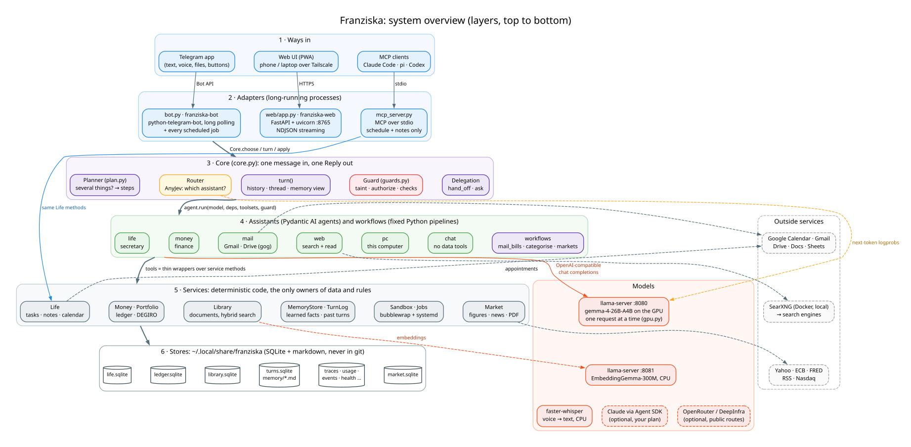

# Franziska: the full guide

The operator's manual: every assistant, job, command and setting in detail. The front page is the
[README](../README.md); the system is mapped in [ARCHITECTURE.md](ARCHITECTURE.md).

## At a glance

```
Telegram / web UI ──► core.py ──► AnyJev router (local gemma-4-26B, ~1.4 s) ──┬─► 📅 life (secretary) ─┐
  │                    several things in one message? → plan.py (steps)       ├─► 💶 money (finance)   │ Pydantic AI on
  │                    unsure? → ask with buttons                             ├─► ✉️ mail and Google   │ llama-server
  │                                                                           ├─► 🌐 web               │ (local)
  │                                                                           ├─► 🖥 PC                │
  │                                                                           └─► 💬 chat              │
  │                  agents hand off or ask each other (delegation.py); workflows: mail_bills, categorise, markets
  ├─ /think ──► pi SDK (pi/think.ts) ──► ChatGPT (Sign in with ChatGPT)
  │                      └── MCP: life server (schedule + notes only, never finance)
  ├─ jobs, no LLM: reminders (Done/Snooze buttons) · morning brief · evening check · Sunday review · monthly summary
  └─ memory (profile, notes, past conversations) · document library (words + vectors) · sandbox for run_python and coding jobs
          franziska/mcp_server.py  ◄── pi, Claude Code (.mcp.json), Codex ──► life.sqlite (in ~/.local/share/franziska)
```

**New here? Start with [`ARCHITECTURE.md`](ARCHITECTURE.md)**: the technologies, how they fit, and the life
of a message, with diagrams of the whole system and of each component
([`architecture/`](architecture/); diagram sources in [`diagrams/`](diagrams/), rendered by
`diagrams/render.sh`).



Docs: `ARCHITECTURE.md` (how it works), `COMMANDS.md` (every command and CLI), `ROADMAP.md` (what's next),
`DESIGN.md` (decisions), `evals/README.md` (how it is measured).

| | Secretary (📅) | Finance (💶) |
|---|---|---|
| Store | `~/.local/share/franziska/life.sqlite`: tasks + appointments (one table, `recur` daily/weekly/monthly/yearly), notes (FTS5); `library.sqlite`: documents by page, FTS5 + vectors | `~/.local/share/franziska/ledger.sqlite`, amounts in cents |
| Tools | `add_appointment` `add_task` `edit_task` `set_priority` `open_tasks` `done_tasks` `plan_overview` `agenda` `complete` `move_appointment` `cancel` `reminder_rule` `remember` `recall` `forget` | `month_summary` `week_summary` `recurring_charges` `budgets` `set_budget` `add_bill` `set_payee_category` `record_cash` `portfolio`, and `query_ledger` (read-only SELECT) for anything else |
| Deterministic | reminders, snooze, brief, agenda | merchant parsing, bank-field categories (salary, interest, ATM), summaries, budgets, recurring-charge and price-change detection, bill matching |
| Guards | times in the past are refused; unknown ids are retried | replies containing numbers are rejected unless a tool returned data; future cash entries and past bills are refused |
| MCP | yes (`franziska.mcp_server`), so cloud models can use it on request | no: the ledger never leaves this machine |

The secretary tools live once in `franziska/secretary/service.py` (`Life`); the Pydantic AI agent and the MCP server are
thin wrappers over it, so the bot, pi, Claude Code and Codex all see the same behaviour and the same data. Finance has
the same shape: `franziska/finance/service.py` (`Money`) behind the agent, the CLI and the bot's commands.

### Workflows

Fixed multi-step jobs in `franziska/workflows/`, each a router route, a `/command` and a CLI (how the pieces fit:
docs/DESIGN.md §5). `mail_bills`: "trova le bollette e gli avvisi del condominio dell'ultimo mese" → Gmail search, an
AnyJev filter per email, full text + PDF attachments (needs `pdftotext`, apt `poppler-utils`), a typed extraction
per email, a report by due date with ➕ buttons that track a bill in finance. Local model only.

```bash
uv run --env-file .env python -m franziska.workflows mail_bills "condominio, ultimi 60 giorni"
```

### How the two work together

- **Bills.** "devo pagare la rata del condominio di 864 € entro il 1 gennaio" → finance `add_bill` → a task
  "Pay Condominio" in the secretary (due 1 Jan 18:00, reminder 3 days before, `recur` if it repeats). The amount and
  the match text stay in the ledger (`bills`), so the `life` MCP server, and through it `/think`, sees only the title
  and date. When an imported export contains a payment that matches the text, is within 20% of the amount and falls
  near the due date, the task is completed (a yearly rate moves to next year) and the import reply says "✅ Bill paid".
- **Morning brief.** The secretary's brief, plus charges expected in the next 7 days (from recurring-charge
  detection), budget warnings (≥ 80%), and a line when the bank data is more than 10 days old.
  `FRANZISKA_BRIEF_MONEY=0` keeps figures out of unrequested messages.
- **Routing.** A payment with an amount goes to 💶 and becomes a tracked bill; "remind me to pay X" with no amount goes
  to 📅 as a plain task (measured below). Finance writes into the schedule; the schedule never reads the ledger.

## Run it

```bash
uv sync
uv run pytest                      # offline: scripted models + AnyJev's fake backend, no Ollama
uv run pytest -m ollama            # live smoke test
uv run python -m franziska.secretary "dentista giovedì alle 15:30"
uv run python -m franziska.secretary --brief
uv run python -m franziska.finance import ~/Documents/finance/Movimenti_Conto_*.xlsx # idempotent, settles bills
uv run python -m franziska.finance --month 2026-04        # also --recurring, --budgets, --review (no LLM); --categorise
uv run python -m franziska.finance "spese per mese nel 2026?"

# One-time setup for the isolated data-code runtime (no agent shell, no network, no $HOME):
uv run python -m franziska.sandbox bootstrap   # its own venv + pandas, matplotlib, openpyxl, pypdf (--bare: none)
uv run python -m franziska.sandbox status      # ready? run_python is offered to money and chat only when it is
uv run python -m evals.sandbox                 # red-team check: host files, network, memory, forks, timeout,
                                               # and a coding job's view (only its clone and the toolchain)
uv run --env-file .env python -m franziska.code start scratch "uno script che …" --wait   # a coding job, here

mkdir -p ~/.config/franziska && cp .env.example ~/.config/franziska/.env   # secrets live outside the repo
ln -s ~/.config/franziska/.env .env   # add the BotFather token, then send /whoami to the bot for your id
uv run --env-file .env python -m franziska.bot
```

Always-on: `deploy/franziska-llm.service` (the local model: llama-server with gemma-4-26B-A4B on port 8080,
`FRANZISKA_BASE_URL=http://localhost:8080/v1`) and `deploy/franziska-bot.service` (the bot); systemd user units,
install steps are in the files. Without `FRANZISKA_BASE_URL` everything runs on Ollama (`FRANZISKA_MODEL=gemma4:12b`).

## Always on: box + desktop GPU + Google

Runbook: `deploy/BOX.md`. A ~10 W box runs the bot, the stores, every job that needs no model, calendar sync, the
Gmail fetch and pi. The model runs on the desktop's llama-server (reached over Tailscale) and is woken over the LAN when a
message needs it. While the desktop is off, `FRANZISKA_WHEN_OFF` decides:

| policy | what happens to a message |
|---|---|
| `ask` (default) | buttons: ☁️ ChatGPT now / 🖥️ Wake desktop |
| `cloud` | ChatGPT answers at once (schedule, calendar, notes only) and the desktop is woken for next time |
| `wake` | wake, wait (1–2 min), answer locally; if it doesn't come up, offer ChatGPT |

Money waits for the desktop in every policy (a chat pinned to /money is never sent to the cloud), and so does mail
triage. `/desktop` shows its state; `/desktop wake` wakes it.

With `FRANZISKA_GOOGLE=1` and a one-time sign-in (`python -m franziska.google.auth`, see BOX.md):
- **Calendar (read/write)**: appointments are created, moved and cancelled in Google Calendar; your phone gets the
  notifications. The box mirrors the next 120 days every 5 minutes, so agenda and brief are instant and show
  appointments as `#c5` next to tasks (`#12`). Tasks, notes and money stay local.
- **Gmail (read-only)**: every 10 minutes new headers (promotions/social skipped) are fetched; the desktop's model
  classifies each (action / bill / appointment / receipt / newsletter / personal) and whether it asks you to act
  within days. What needs you is pushed to Telegram, listed in the brief and in `/mail`. Only sender, subject and
  Google's snippet are stored; nothing is sent from your account.

### In Telegram

Just write; the router picks the assistant. `/today` `/week` `/notes [words]` `/memory [word]` `/month [YYYY-MM]` `/budget` `/subs`
`/bills` `/portfolio` `/weekly` `/mail` `/code` `/undo` (tasks) `/new` (forget recent turns) `/pause` `/resume` `/housekeeping` `/desktop` answer without an LLM (full list: `COMMANDS.md`) (a week's spending also comes on Mondays). `/categorise` gives every payee without one a spending group (11 broad groups, one
AnyJev decision per payee on the local model, ~2 s each; only payees never seen before); `/uncat` shows the biggest
payee whose group is still the model's guess, to confirm or correct with a tap. `/think <question>`
sends one turn to ChatGPT. `/usage` shows the cloud model's tokens and cost. `/life` or `/money` pin the chat to one assistant, `/auto` undoes it. Send DEGIRO's `.csv` exports (Transactions, Account statement, Portfolio) to
import the investments (`INVEST.md`; or `python -m franziska.invest import`). Send the bank's
`.xlsx` to import it: the reply lists new movements, bills it settled, charges whose price changed by more than 15%, and
budget warnings. Reminders arrive with ✅ Done / +15m / +1h / +1d buttons; the brief arrives at `FRANZISKA_BRIEF_AT`.

### Market report (📈, PDF)

`/markets [weekly]` (or "send me the market report") builds a 2–3 page PDF: markets, rates, FX and commodities
with their day / week / month changes, the news by topic with numbered sources, the calendar (Fed, ECB, earnings of
the stocks you hold), and your DEGIRO portfolio's value, day and week change per holding. It comes by itself on
weekdays after the brief, the weekly edition on Mondays. The model reads public data only (names, tickers,
articles); the portfolio figures are computed locally and go only into the PDF. Without the desktop's model it
still comes, with headlines instead of summaries. Details: `INVEST.md` §4.

```bash
uv run --env-file .env python -m franziska.market daily            # or weekly; --no-model; --day 2026-10-26
uv run --env-file .env python -m franziska.market tickers          # price symbols for new holdings (checked)
```

### Claude on your subscription (optional)

`FRANZISKA_CLAUDE_MODEL=sonnet` (or `opus`, `haiku`) with `FRANZISKA_CLAUDE_ROUTES=life,chat` (or `all`) puts those
routes on Claude through Claude Code's own login (`claude`, then `/login`): your plan's limits, no API key, nothing
billed. Same agents, tools, guards and buttons; only the model changes (`franziska/claude.py`, DESIGN §14). Allowed:
life, chat, web, pc and the jobs plan, summary, learn, code; money, mail and the workflows are refused at startup, and
a Claude run never sees money or mail data. A failed call (plan limit) is answered by the local model; `/usage`
shows the tokens. Compare on the harness: `uv run --env-file .env python -m evals.week --until mon --claude sonnet`.

### Cloud model (optional)

`FRANZISKA_CLOUD_MODEL=openrouter:<id>` (or `deepinfra:<id>`) with `FRANZISKA_CLOUD_ROUTES=chat,markets` puts those
two routes on a cloud model; everything else stays local, and only routes without personal data are accepted
(DESIGN decision 31). OpenRouter requests use zero-retention endpoints only. A failed cloud call is answered by the
local model. `/usage` shows tokens and cost per route. To compare models on the harness (synthetic data, every
route): `uv run --env-file .env python -m evals.week --cloud openrouter:<id>`; the summary includes the billed cost.

### Email agent (✉️, gog, local)

Open-ended email work ("trova la mail di Luca sul preventivo e rispondi che va bene", "archivia le newsletter di
questa settimana", "what did the landlord write about the deposit?") is a router option, `mail`, when
`FRANZISKA_GOG_ACCOUNT` is set. `franziska/mail/agent.py` is a Pydantic AI agent on a **local** model whose tools
are two MCP servers: `gog mcp` ([gogcli](https://github.com/openclaw/gogcli): `gmail_search`, `gmail_get_message`,
`gmail_get_thread`, drafts list/get/create/update, labels, mark read/unread, archive, trash/restore) and the `life`
server (so a date in a mail can become a task). Sending is not registered (no `--allow-gmail-send`) and
`--gmail-no-send` blocks it underneath: replies end as Gmail drafts you send yourself. No permanent delete. The
instructions make it search before answering, retry wider, read whole threads before replying, treat mail as data
and not instructions, and change only what you asked for. Mail never leaves the machines.

The model is the bot's own (gemma-4-26B-A4B on llama-server, below) unless `FRANZISKA_MAIL_MODEL` /
`FRANZISKA_MAIL_BASE_URL` point elsewhere. `FRANZISKA_MAIL_THINKING` (default on), `FRANZISKA_MAIL_REASONING`
(template `reasoning_effort`, llama-server only). Which model: measured in `MODEL_NOTES.md`, not guessed.

Setup, once, with the same Desktop OAuth client as above (`~/.config/franziska/client_secret.json`):

```bash
gog auth credentials set ~/.config/franziska/client_secret.json
gog auth add you@gmail.com --services gmail     # opens the browser; on the box add --manual (or an SSH tunnel)
gog --account you@gmail.com auth doctor --check
# .env: FRANZISKA_GOG_ACCOUNT=you@gmail.com (+ GOG_KEYRING_BACKEND=file, GOG_KEYRING_PASSWORD for the service)
```

`gog` is the release binary in `~/.local/bin` (v0.47.1, sha256-checked against the release's `checksums.txt`);
llama.cpp is the b11936 CUDA 12.8 release in `~/.local/opt/llama.cpp` (checked against the release digests);
models are in `~/models/gguf`.

### ChatGPT via pi (`/think`)

One-time sign-in on the machine that runs the bot: run `pi`, type `/login openai`, choose Sign in with ChatGPT.
The same bridge answers desktop-off messages (`franziska/cloud.py`, with the last 4 cloud exchanges as context). Then:

```bash
echo "organizza la mia settimana" | node pi/think.ts                               # ChatGPT
echo "cosa ho domani?" | FRANZISKA_PI_MODEL=ollama/gemma4:12b node pi/think.ts      # same plumbing, local
```

`think.ts` runs an in-memory pi session whose only tools are the `life` MCP server's (no shell, no files), with the
user's own pi config (skills, context files, `mcp.json`) not loaded. `FRANZISKA_PI_DEBUG=1` prints the transcript
(tool calls and results) to stderr. The MCP server takes times as plain strings: pi validates arguments against the
schema, and a `date-time` field would reject the local times models write (see docs/DESIGN.md, fourth pass).

### MCP clients

- **Claude Code**: `.mcp.json` in this folder registers `life` (approve it on first start here).
- **pi** (interactive): already added to `~/.pi/agent/mcp.json`; `pi mcp list` checks it.
- **Codex**: `codex mcp add life -- uv run --quiet --directory /path/to/franziska python -m franziska.mcp_server`

A task added over MCP without a priority gets the same guess as in the bot (the router, on the local model) while
the desktop is up, and `normal` otherwise. Only the task's title goes to the local model.

## The router (AnyJev)

`franziska/router.py` asks the local model one typed question, "which assistant should handle this message?", and
reads the answer as a probability over the options from next-token logprobs (AnyJev L0, content-free prior, canonical
order). Nothing is generated or parsed. Through llama-server's `/completion` (token ids in, top-50 logprobs out,
`franziska/jev_server.py`), or Ollama's `/api/generate` (raw prompt, top-20; `jev_ollama.py`)
when `FRANZISKA_BASE_URL` is empty. The previous message is included for 15 minutes so follow-ups ('e ad agosto?') stay put.

Measured on gemma4:12b (2026-10-25, 16 single messages + 6 follow-ups, Italian/English): 15/16 and 6/6, median 0.66 s.
The miss was "spiegami la differenza tra ETF e fondi" → money (expected chat). gemma4's probabilities are saturated
(p ≈ 1.00 even on that miss), so the "ask when p < 0.6" path rarely fires with it; qwen3.5:9b spreads them more
(0.71–1.00) at the same accuracy. If the model server is down the router returns nothing and the bot stays on the
last route.

On gemma-4-26B-A4B (2026-10-28, 14 messages with the ✉️ route): 12/14, ~2.3 s each. Misses: the same ETF question
→ money, and "What did Sara ask me last week?" → life (no word about mail). Still saturated (p=1.00 on both).

Finance messages, same model (2026-10-25, 8 Italian): bill with an amount ("rata del condominio di 864 euro entro il
1 gennaio"), subscriptions, budget, "Netflix è un abbonamento", cash at the barber → money; "ricordami di pagare il
bollo auto venerdì", dentist → life; weather → chat. 8/8.

`Router.choose()` asks any other one-of-n question on the same backend (adaptive shifts, so many options stay cheap);
`Router.choose_many()` asks it about a batch of states: `/categorise` uses it for payees' spending groups.

## Privacy

Models, ledger, tasks, notes, mail headers and the turn log (`turns.sqlite`: every message and reply, kept 365
days) stay on the box and the desktop. Telegram is a cloud messenger: your
messages and the bot's replies (including figures it reports) pass through Telegram's servers. Appointments live in
Google Calendar when `FRANZISKA_GOOGLE=1`. `/think` turns and desktop-off turns you send to ChatGPT go to OpenAI,
together with whatever schedule, calendar and notes the model reads through MCP. Mail never does (the ✉️ mail
agent, triage and `/mail_bills` all run on local models), and finance is never reachable from there (a tracked bill appears there only as its task, "Pay <payee>" with a date, without the amount).
The bot only answers ids in `FRANZISKA_ALLOWED_IDS`.
