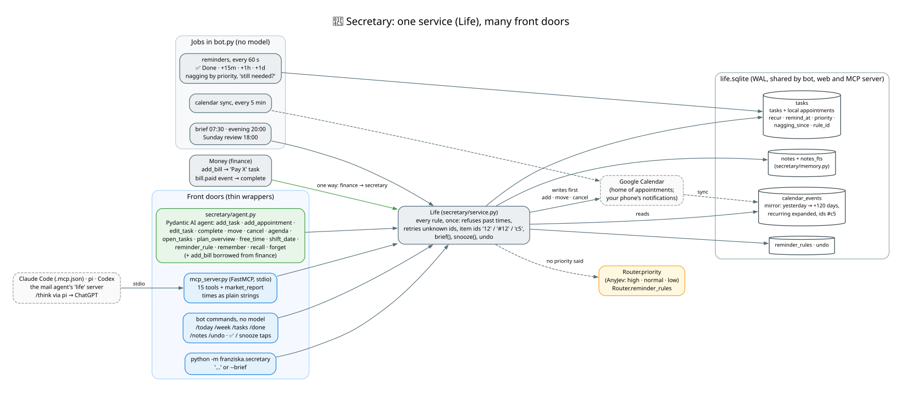
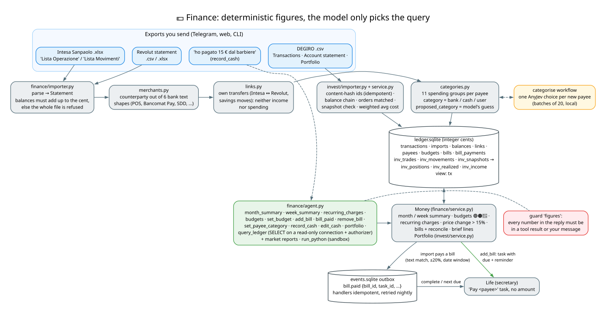
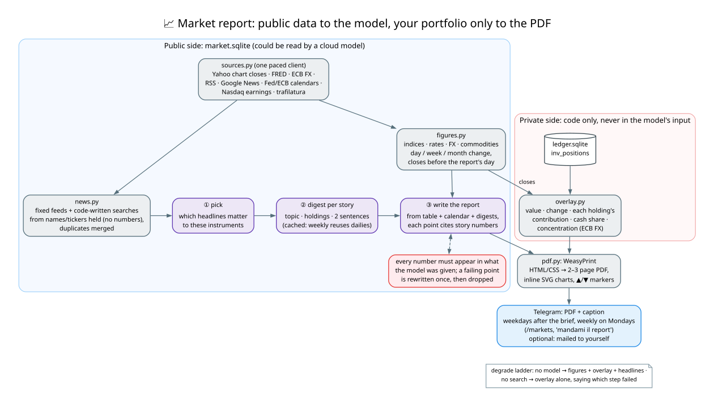
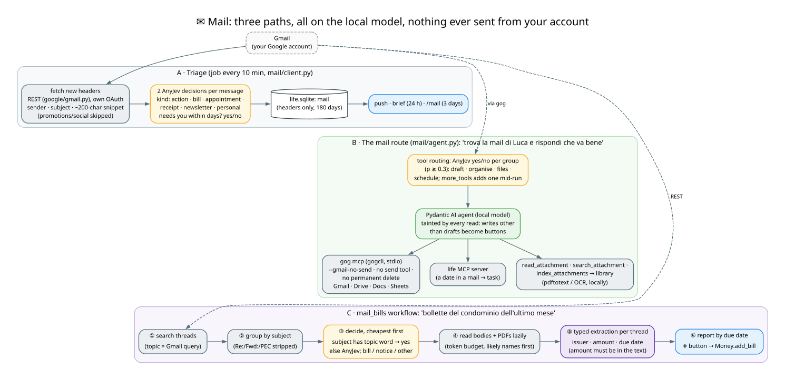

# The assistants, one by one

← [Architecture guide](../ARCHITECTURE.md)

Every assistant has the same shape: **a service** (deterministic code that owns the data and every rule), **a
Pydantic AI agent** whose tools are thin wrappers over the service, and **front doors** (bot commands, CLI, MCP, web
views) that call the same service methods. This page walks through each one.

## 1. 📅 Secretary (`secretary/`, `google/calendar.py`, `mcp_server.py`)

**Service: `Life`** (`secretary/service.py`). Tasks, appointments, notes, reminders and the brief. Methods return
short text for a model or a phone to read, and raise `LifeError` for input the model should correct (the agent turns
that into a retry, the MCP server into a tool error). Item ids reach it as text: `12`, `#12` (a task) or `c5` (a
Google Calendar appointment).

**Store** (`secretary/tasks.py`, `life.sqlite`). Tasks and local appointments share one table (`kind`). Times are
naive local ISO strings in your timezone, and a task's deadline may be a bare day.

- `recur`: daily, weekly, monthly or yearly. A recurring task moves to its next occurrence when completed. A
  recurring event moves once its start has passed.
- one reminder per item (`remind_at`), sent by a job, never by a model;
- **nagging**: an open task with no deadline is reminded again by priority (high every 2 h between 08:30 and 21:00
  on the first day, normal daily, low every 2 days) for 3 days, then asked "still needed?". A deadline is reminded
  15 min before it. Once it has passed, you get one "still needed?" (Done / Keep / Tomorrow / Drop);
- **reminder rules** (`reminder_rules`): your preference ("gym reminders in the evening") is data the store
  applies, not a memory the model must remember. Which rule a task follows is an AnyJev decision on its title,
  stored as `tasks.rule_id`;
- an `undo` table behind `/undo`.

**Google Calendar** (`FRANZISKA_GOOGLE=1`). Appointments live in Google: writes go there first, so your phone gets
the notifications. A mirror table `calendar_events` (yesterday → +120 days, recurring events expanded) is refreshed
every 5 minutes and after each write. Reads come from the mirror, so the agenda and brief are instant and work
offline, and each event gets a short stable id `#c5`. OAuth is the user's own Google Cloud client: a one-time
sign-in, then refresh tokens over plain httpx (`google/auth.py`), with no Google SDK in the bot.

**Agent** (`secretary/agent.py`): `add_task`, `add_appointment`, `edit_task`, `set_priority`, `complete`,
`move_appointment`, `cancel`, `agenda`, `open_tasks`, `done_tasks`, `plan_overview`, `free_time`, `projects`,
`shift_date` (date arithmetic in code: "30 days before 15/01" is a tool call, not mental maths), `reminder_rule`,
`remember`, `recall`, `forget`, plus `add_bill` borrowed from finance, the library tools and the memory tools.
The reply check is `dates`. A new task without a stated priority gets `Router.priority` (normal or low; high is
your word).

**MCP server** (`mcp_server.py`, FastMCP over stdio): the same `Life` methods as 15 tools plus `market_report`, for
Claude Code (`.mcp.json` in the repo), pi, Codex, and the mail agent's own `life` server. Times are plain strings
parsed by the server. Finance is deliberately absent.

**Jobs** (no model): reminders every 60 s with ✅ Done / +15m / +1h / +1d buttons (more than 3 at once come as one
list); the morning brief (today, open tasks by priority, the week, money lines, mail that needs you, failing
components); the evening check-in (open tasks with ✅, 📋 plan tomorrow); the Sunday review.

## 2. 💶 Finance and investments (`finance/`, `invest/`)

**The rule**: the model never computes a figure. It picks which deterministic method to call, or writes a
`SELECT`.

**Import** (`finance/importer.py`). Send the bank's export on Telegram or the web UI, or use
`python -m franziska.finance import FILE`. Supported: Intesa Sanpaolo's "Lista Operazione" and "Lista Movimenti" `.xlsx`, and
Revolut's statement. Each parser returns a `Statement` with its own completeness proof (opening balance +
movements = closing balance, to the cent). A file that doesn't add up is refused whole, never imported in part.
Imports are idempotent.

Then, deterministically:

- `merchants.py` reads the counterparty out of the bank's six text shapes (POS old/new, Bancomat Pay, direct debit,
  transfer in/out, ATM) and normalises it (no legal suffix, no per-payment codes);
- `links.py` pairs money moved between your own accounts (Intesa ↔ Revolut transfers 0–3 days apart with opposite
  amounts, Revolut savings moves), so neither side counts as income or spending. `FRANZISKA_OWNER_NAME` recognises
  your name on transfers;
- `categories.py` assigns 11 broad spending groups **per payee, never per payment**. `category` is authoritative
  (a fact from the bank's fields, a cash entry, or your word) and code never overwrites it. `proposed_category` is
  the local model's guess (one AnyJev choice per payee, the `categorise` workflow). Reports count the guess. A
  correction ("Q8 is transport", `/uncat`) applies to the payee's past and future payments.

**Store**: `ledger.sqlite`, amounts in integer cents; the `tx` view is what `query_ledger` reads. The ledger opens a
connection per call. `query_ledger` runs on a **read-only connection with an SQLite authorizer** that permits only
reads.

**Service: `Money`** (`finance/service.py`): month and week summaries (in / out / net / savings rate vs the
3-month average, top categories), budgets (🟢🟠🔴 and the share of the month gone), recurring charges (gaps of 1–3
months, a mixed payee like Apple split by amount), a price-change alert (> 15 %), data freshness, brief lines, and
bills.

**Bills: the one link to the secretary** (decision 6, one way). `add_bill` writes a row in `bills` (payee, match
text, amount) **and** a task "Pay <payee>" in `Life` (due 18:00 on the day, reminded N days before, recurring if the
bill repeats). The amount stays in the ledger, so the MCP server and the cloud see only the title and date. After
every import, `Money.reconcile` looks for a debit that contains the match text, is within 20 % of the amount, falls
between 25 days before and 15 after the due date, and hasn't been used before. It then emits a `bill.paid` event.
`events.py` is an outbox: the row is written, the handler (`Life.on_bill_paid`) completes the task or moves a
recurring one, and failed handlers are retried nightly and listed in the brief. Handlers are idempotent, and
payloads carry ids and dates, never amounts.

**Agent** (`finance/agent.py`): `month_summary`, `week_summary`, `balances`, `recurring_charges`, `budgets`,
`set_budget`, `bills`, `add_bill`, `bill_paid`, `remove_bill`, `set_payee_category`, `record_cash`, `edit_cash`,
`portfolio`, `query_ledger`, plus the market report readers, the library (it may read mail-class documents: bills
and receipts) and `run_python` in the sandbox. The reply check is `figures`. Money runs only on the local model,
and a chat pinned to money waits for it.

**Investments** (`invest/`, `docs/INVEST.md`). The DEGIRO exports (Transactions, Account statement, Portfolio
`.csv`) are imported into `inv_*` tables in the same ledger. Rows get content-hash ids, so overlapping exports add
nothing. The checks: the statement's cash balance chain per currency, each order present in both files with the same
quantity, amount and fee, and a snapshot's quantities and cash matching the trades up to its day. `Portfolio.rebuild`
recomputes positions, realised gains and income from all stored rows (weighted average cost, the Italian method, in
EUR, fees included). `market/tickers.py` maps each holding to a Yahoo symbol only when its close is within 1 % of a
snapshot's price.

## 3. Market report

`/markets [weekly]`, *"send me the market report"*, or automatically on weekdays after the brief (the weekly edition
on Mondays). It is a 2–3 page PDF. The design splits it into two outputs that never mix (decision 27):

- **The public report** (`market.sqlite`, model-written from public data). `sources.py` is one polite HTTP client
  (one request per host per interval, one retry on 429/503) for Yahoo closes, FRED, ECB FX, RSS feeds, Google News
  searches, Fed and ECB calendars, Nasdaq earnings dates and article text. `figures.py` builds the market table
  (closes before the report's day only). `news.py` collects and deduplicates items, with search queries written by
  code from the instrument names (no numbers). The model then does three typed steps through
  `Ctx.extract(native=True)`: **pick** the headlines that matter, **digest** each story (cached, so the weekly
  edition reuses the dailies), and **write** the report with story citations. Every number the model writes must
  appear in what it was given. A failing point is rewritten once, then dropped.
- **The portfolio overlay** (`overlay.py`, code only, never in the model's input): value, change, each holding's
  contribution, cash share and concentration, from the ledger's positions and the closes (ECB FX).

`pdf.py` renders HTML and CSS through **WeasyPrint**, with charts drawn as inline SVG and gains and losses as ▲/▼
markers next to the number (never colour alone). Degrade ladder: without the model it sends figures, overlay and
headlines; without search, the overlay alone, saying which step failed. It always sends something.

## 4. ✉️ Mail (`google/gmail.py`, `mail/`, `workflows/mail_bills.py`)

Three paths, all on the local model. Mail content never goes to the cloud or Claude, and nothing is ever sent from
your account (the one exception: the market report PDF to your own address, opt-in).

**A. Triage** (`mail/client.py`, every 10 min). New Gmail headers (sender, subject, ~200-character snippet;
promotions and social skipped) go into the `mail` table in `life.sqlite`, with no bodies. AnyJev decisions per
message: its **kind** (action, bill, appointment, receipt, newsletter, personal) and whether it **clearly needs you**:
three yes/no questions (a sender you actually deal with, not marketing or a platform notification; something to do or
acknowledge; a real cost if ignored for a week), `urgent_p` the lowest. Only those (≥ 0.5) are pushed, one message
each with ✅ Got it / 🔇 Not important (mutes that sender's pushes, `mail_muted`), and listed in the brief (last 24 h).
Your own mail is never pushed. `/mail` still lists every action/bill/appointment of the last 3 days. Untriaged mail
waits for the model.

**B. The mail route** (`mail/agent.py`, needs `FRANZISKA_GOG_ACCOUNT`): open-ended work like *"trova la mail di Luca
sul preventivo e rispondi che va bene"* or *"archivia le newsletter"*. Its tools are **two MCP servers** rather than
code of our own:

- `gog mcp` (gogcli): Gmail search, read messages and threads, drafts, labels, read state, archive, trash; Drive
  search; Docs read and append; Sheets read and update. Started with `--gmail-no-send` and without the send tool, so
  a reply ends as a draft you send yourself. There is no permanent delete. `_Rules` refuses replacing a whole Doc.
- the `life` server (a date in a mail can become a task or an appointment);
- plus three tools of its own: `read_attachment`, `search_attachment` and `index_attachments` (attachments read
  locally with pdftotext and OCR, and kept in the library).

**Tool routing**: the model would otherwise see ~45 tool definitions every turn. The read tools, attachments and
memory are always there. The groups *draft*, *organise*, *files* and *schedule* are added when an AnyJev yes/no on
the message says so (p ≥ 0.3, lenient on purpose), and `more_tools(group)` adds a group mid-run. Every read taints
the run, so writes other than drafts become buttons, replayed on the tap in a fresh MCP session (`call_now`). Gmail
search results are compacted to one line each inside one untrusted-content wrapper (about 3× less text).

**C. `mail_bills` workflow**: *"trova le bollette e gli avvisi del condominio dell'ultimo mese"*. It follows three
rules that apply to any workflow:

- **cheapest check first**: the topic is the Gmail query, a subject containing it counts as on topic in code, and
  only the rest get an AnyJev yes/no;
- **work per conversation**: threads are grouped by subject without Re:/Fwd:/PEC prefixes, with one request per
  thread;
- **read lazily**: attachments are read likely names first, within a token budget, never images, signatures or PEC
  envelopes.

One typed extraction per thread gives issuer, amount and due date; an amount not literally in the text is dropped.
The report is sorted by due date, with a ➕ button that calls `Money.add_bill`. The workflow learns the
condominium's sender into the `mail` memory scope and keeps the attachments in the library.

## 5. 🌐 Web (`search.py`)

For questions about the world right now (*"cerca notizie sulle proteste di oggi"*, *"a che ora chiude il
Louvre?"*). Tools: `web_search`, `news`, `read_page` (trafilatura for HTML, pdftotext for PDFs, in ~5000-character
parts) and `keep_page` (save a page to the library as `public`, when asked).

Searches go to the self-hosted **SearXNG** (`deploy/searxng`, Docker, port 8888), which merges DuckDuckGo, Brave,
Google CSE, Mojeek and Wikipedia. Without it, the route uses DuckDuckGo's HTML page and Google News' feed. One paced
HTTP client is shared with the market report.

What it may not do is enforced in code, not in the prompt. It has no memory, schedule, money or mail tools and no
profile in its instructions, so nothing personal can reach a query. A number in a query must be a year or appear in
your message. Its results are untrusted. Reply checks: `links` (every URL from a result) and `searched` (answer
only after searching). Web may run on a cloud model or Claude.

## 6. 🖥 PC (`pc.py`, `FRANZISKA_PC=1`)

Questions about this computer (*"quanto spazio libero ho?"*, *"il bot ha errori?"*, *"mandami l'ultima foto"*)
without a shell. Every tool is rung-1 code over `/proc`, `statvfs`, `ps`, `systemctl --user` and
`journalctl --user` (Franziska's own units only) and the file system, with typed arguments passed as lists:

`system_status`, `top_processes` (command names only, never arguments, which can carry tokens), `services`,
`service_log`, `find_files`, `list_folder`, `folder_sizes`, `read_file`, `send_file` (attach up to 50 MB),
`coding_jobs`, and the proposals `propose_move`, `propose_trash` (`gio trash`), `propose_restart`,
`propose_coding_job`.

Files are reachable only inside `FRANZISKA_PC_FOLDERS` (default: the XDG user folders plus the coding
repositories), never a hidden path or a name that looks like a key, with symlinks resolved first. Reading a file or
a log taints the run, and a coding job is never proposed by a tainted run. Nothing changes without your tap.

## 7. 💬 Chat

General knowledge and small talk. Its only tools are `hand_off` (*"cerca sul web…"* goes to web) and, on the local
model, `run_python` for a pasted CSV or JSON calculation. It reads the profile index, but not on a cloud model. It may
run on Claude or a cloud model.
