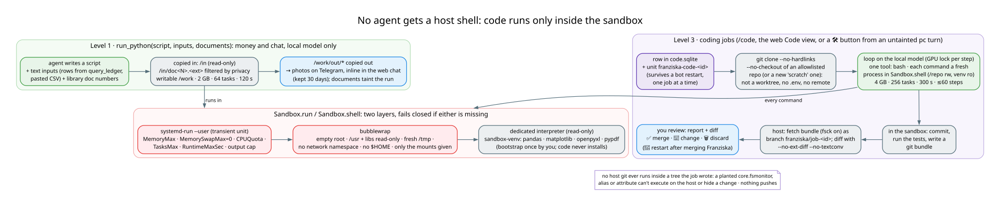

# Code execution: the sandbox, run_python, coding jobs

← [Architecture guide](../ARCHITECTURE.md)

**No agent receives a host shell** (decision 43). Model-written code runs in exactly one place, `Sandbox`
(`franziska/sandbox.py`), and there are exactly two ways in: `run_python` during a chat turn (level 1) and coding
jobs you start yourself (level 3). The 🖥 PC route (level 2 in the proposals) turned out to need no shell at all:
its tools are typed code, see [assistants.md](assistants.md#6--pc-pcpy-franziska_pc1).



## 1. The sandbox: two layers, fails closed

| layer | provides | how |
|---|---|---|
| **systemd-run --user** (a transient unit) | resource limits enforced by the kernel's cgroups | `MemoryMax`, `MemorySwapMax=0` (past the limit the job dies at once instead of swapping), `CPUQuota`, `TasksMax`, `RuntimeMaxSec`, and an output size cap |
| **bubblewrap** (`bwrap`) | the file system and network view | an **empty root**; the system's `/usr` and libraries read-only; a fresh `/tmp`; no network namespace (no network at all); no `$HOME`; only the mounts given; only the environment given |

If either layer can't start, execution **fails closed**, and `Core` offers `run_python` only when
`Sandbox.problem()` returns nothing. **Private inputs and network never coexist** in a sandbox.

The interpreter is a dedicated, read-only virtual environment (`~/.local/share/franziska/sandbox-venv`), not
Franziska's own. You create it once with `python -m franziska.sandbox bootstrap` (the only step that uses the
network): the distro's Python plus pandas, matplotlib, openpyxl and pypdf, wheels only. Model code never installs
anything.

`python -m evals.sandbox` is the red-team check. It verifies that host files, Docker, the network, other processes,
system writes, memory, the process count and the timeout are all out of reach, and checks what a coding job sees.

## 2. Level 1: `run_python(script, inputs, documents)`

Offered to **money** and **chat**, on the local model only (never on a cloud model).

- **Inputs are copied in**, read-only, under `/in`: text the model passes (rows it got from `query_ledger`, a pasted
  CSV), and on money, library documents by number. Those are filtered by the same privacy table as
  `read_document` and placed as `/in/doc<N>.<ext>` (the original file or its text). Reading documents taints the
  turn.
- `/work` is writable. Defaults: 2 GB, 64 tasks, 120 s (`FRANZISKA_SANDBOX_TIMEOUT_S`), 1 MB of output.
- Regular files left under `/work/out` are copied out and go with the reply: a chart arrives as a photo on Telegram
  and inline in the web chat. They are kept 30 days.

Typical use: *"fammi un grafico delle spese per mese nel 2026"*. The money agent queries the ledger and passes the
rows in, and the script draws a matplotlib chart.

## 3. Level 3: coding jobs (`franziska/code.py`)

You ask for a change, a local agent makes it in the sandbox, and you review a branch.

```
/code franziska aggiungi un comando /uptime              (Telegram; or the web UI's Code view, or a 🛠 button)
python -m franziska.code start scratch "uno script che rinomina le foto per data" --wait
python -m franziska.code list | show <id> | merge <id> | discard <id>
```

**Who can start one**: only you, via `/code`, the web form, or a tap on a 🛠 button the pc assistant proposed in an
*untainted* turn (a request that came from a file or a log never becomes a job).

**A job, not a chat turn.** A row in `code/code.sqlite`, and its own systemd user unit `franziska-code-<id>`
running `python -m franziska.code run <id>`. It survives a bot restart (a job may be changing the bot), only one
runs at a time, `RuntimeMaxSec` backs up `FRANZISKA_CODE_MINUTES`, and the bot announces finished jobs every 20 s.

**The workspace** is a `git clone --no-hardlinks --no-checkout` of a repository allowlisted in
`FRANZISKA_CODE_REPOS`, or a new `scratch` repository. It is deliberately **not a worktree**: a worktree's git
metadata lives in the original's `.git`, which would have to be writable from the sandbox. The clone has no `.env`
(untracked) and no remote.

**The loop** follows mini-swe-agent's shape, but is written on Pydantic AI and the local model:

- one tool, `bash`; each command is a fresh process in `Sandbox.shell` with the clone at `/repo`, the repository's
  `.venv` and its interpreter read-only at their own paths, a throwaway HOME and no network; 4 GB, 256 tasks and
  300 s per command;
- a linear history: past the latest 6 steps, outputs and long commands shrink to 400 characters and old reasoning
  is dropped (`code._trim`), so 60 steps fit in a 32k window;
- the same command three times in a row is refused; thinking is on (`FRANZISKA_CODE_THINKING`); the model's final
  answer becomes the report;
- each step takes the GPU lock, so your chat turns interleave with the job's steps.

**What comes back.** In the sandbox: commit whatever the agent left, run the tests, write a git bundle. On the host:
fetch the bundle (with fsck) into the original repository as branch `franziska/job-<id>` (scratch:
`code/scratch.git`), and compute diff, stat and file list there with `--no-ext-diff --no-textconv`. **No host git
ever runs inside a tree the job wrote**, so a planted `core.fsmonitor`, alias or attribute can't execute on the host
or hide a change from your review.

**Review** (Telegram or the web UI's Code view): the report, the diff and the buttons:

- ✅ **merge**: only into the branch the job started from, which must be checked out with no uncommitted tracked
  changes; a conflict aborts;
- 💬 **change**: your next message becomes a follow-up job on the same branch;
- 🗑 **discard**;
- 🔄 **restart**, after merging Franziska itself.

Nothing pushes, deploys or restarts by itself. `/pause` stops a job between two commands.
