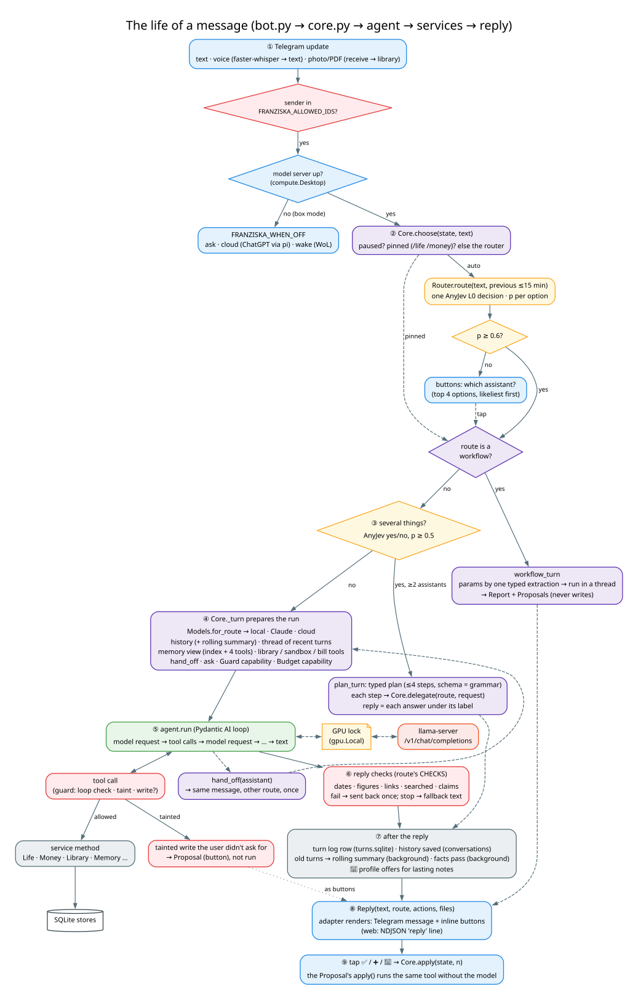
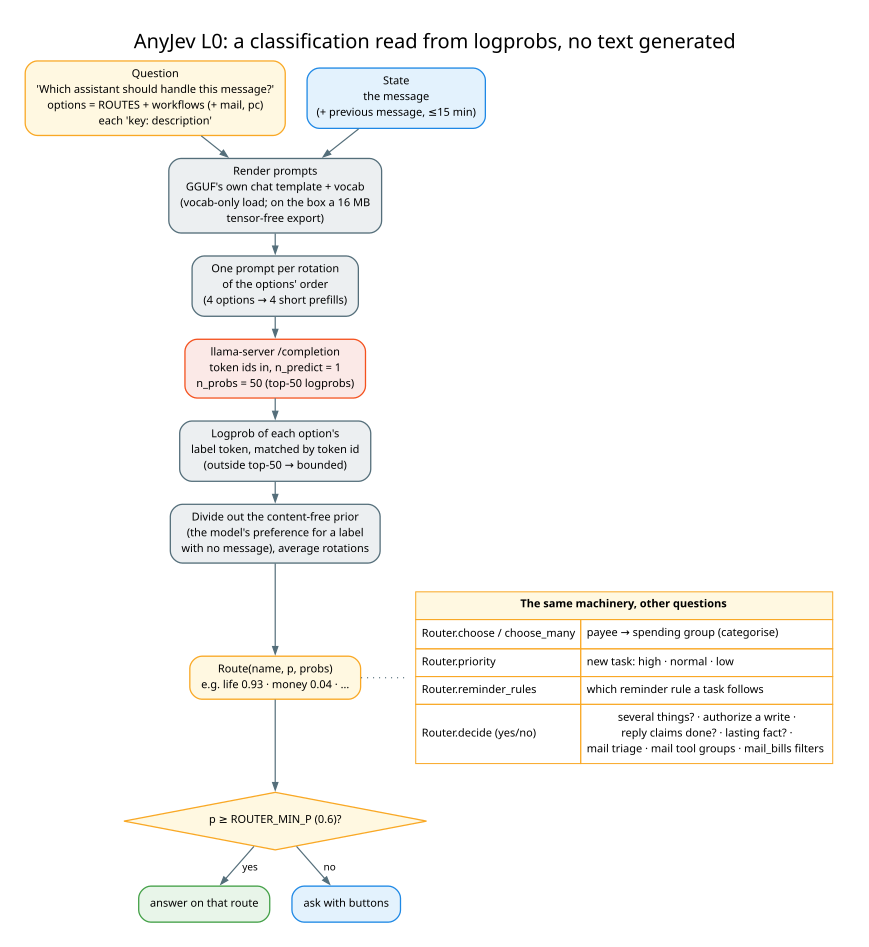
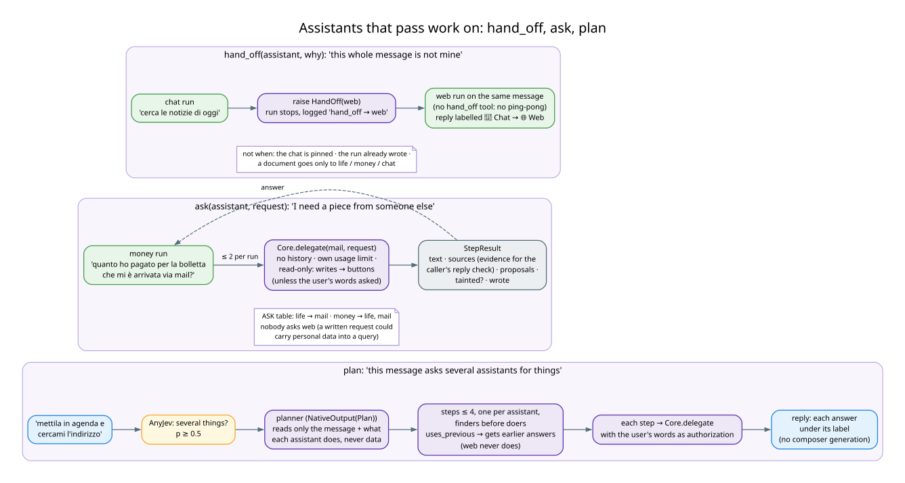

# The core: adapters, routing, turns, planning, buttons

← [Architecture guide](../ARCHITECTURE.md)

`franziska/core.py` is the heart of the system. It knows nothing about Telegram or HTTP: an adapter hands it a
conversation's state and some text, and gets back a `Reply`. This page covers the core itself and the modules
around it that decide *who* answers: `router.py`, `plan.py`, `delegation.py`, `workflows/`, `conversations.py`.



## 1. One core, several adapters

| adapter | process | what it adds on top of `Core` |
|---|---|---|
| `bot.py` (`Bot(Core)`) | `franziska-bot` | Telegram handlers (text, voice, documents, photos, buttons, ~30 `/commands`), the desktop-off policy, every scheduled job |
| `web/app.py` | `franziska-web` | HTTP endpoints, NDJSON streaming, cookie sign-in, read-only views (Today, Money, Memory, Data, Code, Settings), Datasette and the Phoenix proxy |
| `workflows/__main__.py`, CLIs | one-off | run a workflow or a service from a terminal on the same `Core` and model |

`Core.__init__` wires everything once per process, in this order:

1. `Models` (the model per route, see [models-and-guards.md](models-and-guards.md)).
2. The services `Life`, `Money`, `Portfolio`, `MemoryStore`, `TurnLog`, `Conversations`, `Events`, `Health`.
   `Money` gets the event bus, and `Life` subscribes to it, so `bill.paid` reaches the secretary.
3. The `Sandbox` (checked once: `run_python` is offered only if bubblewrap, `systemd-run` and the sandbox venv
   exist), the `Library`, and the Gmail client and mail store when Google is configured.
4. The workflows whose needs are met (`Workflow.available`). Each becomes a route.
5. The `pc` and `mail` routes when configured (`FRANZISKA_PC`, `FRANZISKA_GOG_ACCOUNT`).
6. The `Router` over all those route descriptions. It also gives `Life` its priority guesser and reminder-rule
   classifier.
7. `prompt_problems()`: a startup check that logs any tool an agent's rules mention but the agent doesn't have in
   this configuration. A prompt that promises a missing tool makes the model invent it.

### Conversation state

A conversation is a plain `dict` that the adapter stores: Telegram's `chat_data`, or the web app's single session.
The keys:

| key | holds |
|---|---|
| `mode` | `auto` (router) or a pinned route (`/life`, `/money`) |
| `last` | `(route, text, unix time, reply, notes)`: follow-up context for the router and the thread |
| `("history", route)` | the route's recent turns as Pydantic AI messages |
| `("summary", route)` | the rolling summary of turns that left the history |
| `held`, `held_seq` | values waiting for a button (proposals, messages to route), newest 50 |
| `cloud_history` | the last few ChatGPT exchanges (desktop-off fallback) |

`conversations.py` persists `mode`, `last`, histories and summaries in `turns.sqlite`, so a restart doesn't forget
the conversation. Held buttons are Python callables and can't be persisted: after a restart an old button answers
"expired".

Concurrency: `Core.busy(chat_id)` is an `asyncio.Lock` per conversation, so one chat's turns don't interleave.
Other chats, commands and taps go on meanwhile. Local model requests are serialised separately by the GPU lock.

### Pause

`/pause` writes a `paused` file in the data dir, and `/resume` deletes it. It's a file so the bot and the web UI
(two processes) agree. While it exists, no agent, workflow or cloud turn runs and the model and push jobs skip.
Reminders, the calendar mirror, the backup, commands and taps keep working.

## 2. Routing



`router.py` asks the local model **one typed question**: *"Which assistant should handle this message?"* The options
are `ROUTES` (life, money, web, chat), each with a sentence-long description, plus one option per workflow and the
`mail` / `pc` routes when on. Descriptions measurably beat bare labels.

How AnyJev reads the answer:

1. The prompt is rendered with the GGUF's own chat template and vocabulary (`llama-cpp-python` loads it
   vocab-only, with no weights). That way the label tokens are exactly the ones the server sees.
2. One prompt per rotation of the option order. Four options means four short prefills, which removes position
   bias.
3. `jev_server.py` sends token ids to llama-server's `/completion` with `n_predict=1, n_probs=50` and reads the
   logprob of each option's label token, matched by token id. A label outside the top 50 gets the 50th value. That
   is an upper bound, so it can only make the decision *less* confident.
4. The content-free prior (how much the model likes each label with no message) is divided out and the rotations
   are averaged. The result is `Route(name, p, probs)`.

`Router.confident` compares p with `FRANZISKA_ROUTER_MIN_P` (0.6). If it's unsure, `Core.ask_route` offers up to
four buttons, likeliest first. If the router is down, it asks and never guesses, and `health.py` records the
failure so replies say so. The previous message counts as context for 15 minutes (`FOLLOW_UP_S`), so
*"e ad agosto?"* stays on the money route.

Costs and caveats: about 2 s per message on the 26B (4 prefills that Gemma's sliding-window cache can't share).
Gemma's probabilities are *saturated* (p ≈ 1.0 even when wrong), so the "ask when unsure" path rarely fires. The
router is accurate (12–15/16 in the README's measurements), but the threshold is a weak safety net.

The same `Router` object answers other questions on the same backend: `choose` / `choose_many` (one-of-n, batched),
`decide` (yes/no `Question.noul`), `priority` (high / normal / low for a new task) and `reminder_rules` (which rule
a task's reminders follow). `Core` builds its own yes/no checks on `decide`:

| check | question (abridged) | threshold | used by |
|---|---|---|---|
| `SEVERAL_Q` | does this message ask for two or more separate things? | 0.5 | planner gate |
| `AUTHORIZE_Q` | is this action one the user's message asks for, with these details? | 0.8 | guard: a tainted or delegated write runs instead of becoming a button |
| `CLAIM_Q` | does the reply say this is already done, rather than waiting for a tap? | 0.5 | guard: claims check |
| `PROFILE_Q` | is this a trait of the user that stays true for years? | 0.7 | 💾 profile offer after `remember` |

Each threshold was measured on the live model; the numbers sit next to the constants in `core.py`.

## 3. A turn: `Core.turn` → `Core._turn`

`turn(chat_id, state, route, text, p, said, tainted)` is the entry point for an assistant route:

1. Paused? Reply that it's paused.
2. **Planner gate.** In auto mode, for the user's own text (`said is None`, untainted), when at least two plannable
   assistants exist: ask `SEVERAL_Q`. If yes, run `plan_turn`. A plan of fewer than two steps falls through to the
   normal turn.
3. **Hand-offs.** `_hand_offs` lists whom this assistant may pass the message to (nobody in a pinned chat; with a
   document, only `life`, `money`, `chat`).
4. `_turn` runs the agent (below). If it raises `HandOff`, the same message runs once more on the named route,
   without a hand-off tool. The reply then carries `handed_from`, and its steps start with "↪️ 💬 Chat → 🌐 Web: why".

What `_turn` assembles for the agent run:

| piece | from | notes |
|---|---|---|
| agent, deps, model, where | `_agent(route, …)` | `where` is `local`, `claude` or `cloud` and narrows every privacy filter below |
| history | `state[("history", route)]` with the rolling summary as its first message | per assistant: the money agent never sees the life agent's turns here |
| thread | `_thread(...)` | the chat's last 8 turns within 12 h across assistants, filtered by `privacy.SEES`; the turn just before is always included for a local run (follow-ups) |
| memory view | `_view(route, said, where)` | scope = the route (`life`, `money`, `mail`); chat reads only the profile and has no memory tools |
| instructions | `memory.instructions(view)` + the thread | none for web, and none for a cloud chat turn: nothing personal leaves |
| toolsets | `_toolsets(...)` | memory tools; mail's attachment tools; life's `add_bill`; money's market reports; the library for life/mail/money/web; `run_python` for money/chat on the local model; `hand_off`; `ask` |
| capabilities | `[guard, budget.capability()]` | the guard checks every tool call and the reply; the budget trims old tool output before each request |
| message | `[Tue 10 Nov 19:15] <text>` | every message carries its timestamp; without it the model took "today" from an earlier turn |

Failure handling is explicit:

| failure | reply |
|---|---|
| `guards.Stopped` | the guard's fallback: tool lines of what was saved or looked up, no model involved |
| `gpu.Busy` | "⏳ busy, try again in a bit" (an eval or another job holds the GPU) |
| context full with history | retried once without history, with a "🧹 earlier messages no longer fit" note |
| context full without history | "That's more than I can read in one go. Narrow it down." |
| runaway response | the guard's fallback |
| anything else | "Something went wrong on my side (Type: msg)" and the turn log records `error: Type` |

After a successful run: the turn log row, the history saved, `_age` (turns past the cap are queued for the rolling
summary), `_learn` (a background facts pass once enough new turns came and the chat pauses), and `_profile_offers`
(one `PROFILE_Q` per `remember` call). Then come the buttons.

## 4. Planning, hand-off and ask



Three mechanisms, for three situations:

**`hand_off(assistant, why)`**: "the whole message is someone else's". Raised as an exception so the run stops at
once. Not offered in a pinned conversation, refused after the run already wrote something, and the second run has
no hand-off tool, so a message can't bounce.

**`ask(assistant, request)`**: "I need one piece from someone else". The table `delegation.ASK` allows
life → mail and money → life and mail, at most 2 asks per run, depth 1 (the callee has neither tool).
`Core.delegate` runs the callee:

- on the request alone, with no history and its own usage limit;
- **read-only**: its writes come back as proposals on the caller's reply, unless the user's own words authorize
  them (`_authorizer(said)`);
- returning a `StepResult`: text, `sources` (its tool results, which count as evidence for the caller's reply
  check), proposals, `wrote`, `tainted`.

Nobody asks `web`, because a request an agent writes could carry personal data into a search query. Life doesn't
ask money (decision 6: the secretary never reads the ledger).

**The planner** (`plan.py`, `Core.plan_turn`): "this message asks several assistants for things"
(*"mettila in agenda e cercami l'indirizzo"*):

1. Gate: `SEVERAL_Q` ≥ 0.5 (measured: all 11 multi-assistant messages of a simulated month pass, 6 of 127 single
   ones do and then plan to one step).
2. One typed generation, `NativeOutput(Plan)`, so the JSON schema becomes llama-server's grammar. It reads **only
   the user's message and the assistants' descriptions**, never data, so nothing untrusted can shape the steps
   (plan-then-execute). The planner runs on Claude only when no step is money or mail.
3. `plan.checked`: allowed assistants only, at most 4, one per assistant (repeats merged), and at least 2 steps,
   or else the normal turn answers.
4. The steps run in order through `Core.delegate`, with the user's words as authorization. A step with
   `uses_previous` gets the earlier answers it may see (a step on Claude never gets money's figures), plus an
   instruction to decide any condition from them and act. A web step never gets earlier results.
5. The reply is each answer under its label. There is no composer generation, so there is one less place to invent.
   The turn log gets a `plan` row with each step as a child row (`parent`).

## 5. Buttons and proposals

Two kinds of button, both rendered by the adapter from `Reply.actions` (`Action(id, label)`):

| kind | id | made by | on tap |
|---|---|---|---|
| **proposal** (a write) | `wf:<n>` | `Core.actions(state, proposals)` | `Core.apply(state, n)` runs `Proposal.apply()` once, in a thread |
| **choice** | `<kind>:<n>:<key>` | `Core.buttons(state, kind, value, labels)` | `Core.take(state, kind, n)` returns the held value once; the other buttons of that choice expire |

`Core.hold` keeps the newest 50 held values per conversation and gives each its own number, so a tap on an old
message never applies a newer proposal.

A `workflows.Proposal(label, apply)` comes from:

- a **workflow** (always: workflows never write; `mail_bills`' ➕ Bill, `categorise`'s "confirm all");
- the **guard's** `defer`, when a tainted run calls a write. The same tool call is replayed on the tap without the
  model (`Core._defer`: a function tool with its deps, or the mail route's MCP tool in a fresh MCP session);
- **memory**: `learn(..., profile=True)` and the 💾 offer after a lasting note;
- a **delegated** step's writes;
- the **pc** route (move, trash, restart a service, start a coding job).

`Core._remembered` wraps each proposal so a tap is also written into the route's history ("the user tapped …").
Without it, the agent would still believe the write was pending on the next turn.

## 6. Workflows

A workflow is a fixed job written as plain sequential Python over the services:
**search → decide → read → extract → report**. One file each, registered in `workflows.ALL`:

```python
WORKFLOW = Workflow(name="mail_bills", title="🧾 Mail bills",
                    description="mail_bills: …what the router reads…",
                    params=Params,            # pydantic model, filled from the message by one typed call
                    run=run,                  # (Ctx, Params) -> Report(text, proposals, files)
                    needs=("gmail",), scope="mail")
```

That one declaration makes it:

- a **router option** (its `description`);
- a **`/command`** (`/mail_bills`; a bare command takes the default params without a model call);
- a **CLI** (`python -m franziska.workflows mail_bills "condominio, ultimi 60 giorni"`);
- a **web UI form** (`/api/workflows/{name}`);
- part of a **memory scope** (`scope`): that route's `past_conversations` sees its runs, and its turns get the
  scope's privacy class.

`Ctx` gives the workflow the services, the router (`ctx.router.decide/choose`) and `ctx.extract(Model, instructions,
text, native=…)`, which is one typed Pydantic AI call. Workflows run in a thread (`Core.workflow_turn`). They report
progress lines through `ctx.progress`: Telegram edits a status message, and the web UI streams `status` lines.

| workflow | what | model use |
|---|---|---|
| `mail_bills` | bills and notices in Gmail over a period → report with ➕ buttons | AnyJev filters, one extraction per thread |
| `categorise` | spending group for every payee without one | one AnyJev choice per payee, batches of 20 |
| `markets` | the market report PDF | pick, digest and write (see [assistants.md](assistants.md#3-market-report)) |

## 7. Documents and voice

- **Voice** (`voice.py`): faster-whisper on the CPU. The transcript becomes the message text.
- **A file** (`Core.receive`, blocking, run in a thread): an Intesa or Revolut statement is imported into the ledger
  and the reply is the import report. DEGIRO CSVs are imported into the investment tables. Anything else is read to
  text (`documents.text_of`) and added to the library.
- **`Core.document`**: the text becomes a message for an agent (the caption, or a standard request to say what the
  document is and what you must do about it). The route is the pinned one, or the router's best among
  `DOCUMENT_ROUTES` (life, money, chat). The agent sees the first 6000 characters plus the document's number and
  reads the rest with `read_document`. The run is **tainted**: the document was written by someone else.
- A new document gets a **card** in the background (`Core.describe_new`): a typed generation of what it is plus 5–8
  everyday search words, appended to its title. A contract that never says "palestra" is then found by "palestra".

## 8. The desktop-off path (box mode)

`bot.on_text` checks `compute.Desktop.is_up()` before choosing a route. On a single machine the desktop is always
up. On an always-on box with the model on a sleeping desktop, `desktop_off` applies `FRANZISKA_WHEN_OFF`:

- `ask`: buttons ☁️ ChatGPT now / 🖥️ Wake desktop;
- `cloud`: `Core.cloud_turn` (pi → ChatGPT, with the `life` MCP server as its only tools and the last 4 cloud
  exchanges as context), and a Wake-on-LAN packet so the desktop is up next time;
- `wake`: send the magic packet, wait up to `FRANZISKA_WAKE_TIMEOUT_S`, then answer locally.

A chat pinned to money always waits for the desktop. The ledger is never reachable from the cloud.
