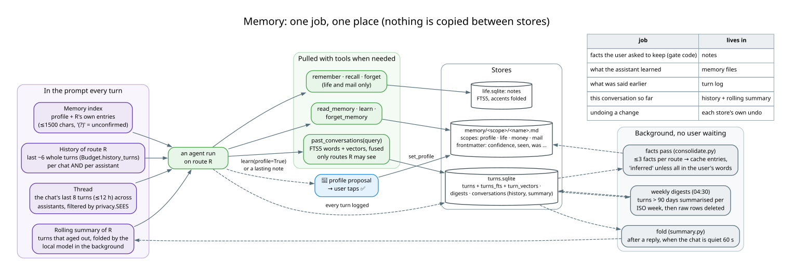
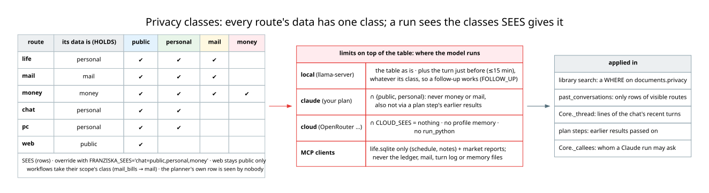
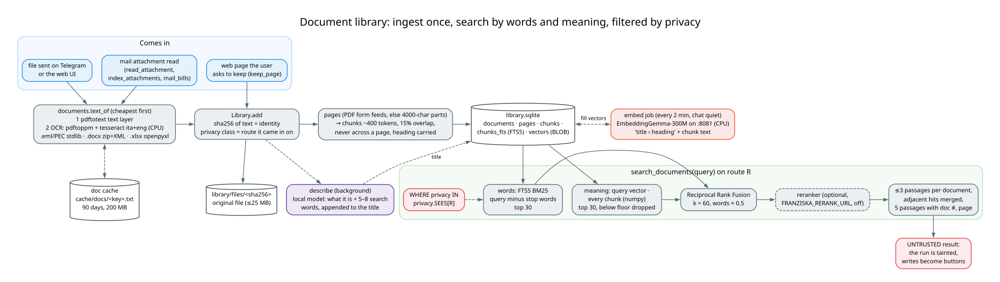

# Memory, privacy, and the document library

← [Architecture guide](../ARCHITECTURE.md)

What Franziska keeps between messages, who may read it, and how documents become searchable. Modules:
`memory.py`, `turns.py`, `summary.py`, `consolidate.py`, `conversations.py`, `secretary/memory.py`, `fts.py`,
`privacy.py`, `library.py`, `documents.py`, `doccache.py`.



## 1. Five kinds of memory, one job each

| kind | what | written by | read by | store |
|---|---|---|---|---|
| **history** | the last ~6 whole turns of *this* chat with *this* assistant | the core, after each turn | the same assistant, every turn | `conversations` in `turns.sqlite` |
| **rolling summary** | a short text of what aged out of the history | `summary.py`, local model, in the background | the same assistant, as the first history message | `conversations` |
| **turn log** | every answered message with its route, tool calls, verdict, latency | the core, every exit path | `past_conversations`, the thread, evals, debugging | `turns.sqlite` |
| **notes** | facts *you* asked to keep: gate code, sizes, passport number | `remember` (life, mail) | `recall` (also over MCP) | `notes` + FTS5 in `life.sqlite` |
| **memory files** | what the assistant *learned*: "il dentista = Dr. Bianchi", your address | `learn`, the facts pass, a 💾 tap | the memory index in every run, `read_memory` | `memory/<scope>/<name>.md` |

The rule is **one job, one place** (decision 21). Nothing is copied from one store into another. Undoing a change is
each store's own undo (`/undo` for tasks); the turn log records but never reverts.

### History, thread and summary: what an agent sees of the conversation

- **History is per assistant.** The money agent's history holds only money turns. That keeps each agent's prompt
  small and on topic.
- **The thread** (`Core._thread`) fills the gap: the chat's last 8 turns within 12 hours, across assistants, as
  short lines ("[Tue 10 Nov 19:02] to 💶 Money: … answer: …"). It is filtered by privacy (§3). A local run always
  sees the turn just before, whatever its class, because a follow-up like *"ricordami di pagarlo"* refers to it.
- **The rolling summary** (`summary.py`): turns past the history cap, or folded out when the window passes 60 %,
  are queued. When the chat has been quiet for 60 s, a background task on the local model folds them into one short
  text per chat and route. The originals stay in the turn log.

### Memory files (`memory.py`)

One markdown file per fact, with flat `key: value` frontmatter (no YAML dependency):

```markdown
---
name: condominium-sender
description: condominium mail (rate, convocazioni) comes from studio-rossi@example.it
kind: cache
confidence: inferred
seen: 2
source: mail_bills 2026-10-28
created: 2026-10-28
last_used: 2026-11-02
---
Also PEC from amministrazione@pec.studio-rossi.it.
```

- **Scopes** follow the domain of the data, named like the routes: `profile` (read by every agent, written only
  after your ✅, `/memory` or by hand), `life`, `money`, `mail` (each read and written by its own agent).
- **Agent tools**, added at run time by `memory.toolset(view)`: `read_memory(name)`, `learn(name, fact, detail,
  profile=False)`, `forget_memory(name)`, and `past_conversations(query)`. With `profile=True`, `learn` writes
  nothing: it adds a 💾 proposal.
- **The index** goes into the agent's instructions every turn: the profile first, then the scope's entries by last
  use, up to 1500 characters. Entries not yet confirmed show `(?)`.
- **Trust is code** (decision 20). A fact is `stated` when every name, number and address in it appears in your
  own message (`said_by_user`), and `inferred` otherwise (mail and workflow facts always are). Learned again on
  another day with the same content: `seen + 1`, confirmed at 2. Learned with different content: a correction
  (`corrected + 1`, the old value kept in `was`).
- **Links**: `[[name]]` in a fact. `read_memory` follows links one hop both ways, but only within scopes the reader
  may see.
- **Housekeeping is code**, not model judgement: writing to a name replaces it, at most 200 cache entries per scope
  (the unconfirmed ones are evicted first, then the least recently used). Learned facts don't expire by default
  (`EXPIRE_DAYS = None` in code; DESIGN §6 describes the earlier 60-day rule). Delete them with `/memory` or the
  web UI.

### The turn log (`turns.py`)

One row per answered message: `at, chat_id, route, p, text, reply, tools, stopped, ms, tokens, said, doc, parent`.
`tools` is the guard's call list (results cut to 2500 chars). `stopped` is a guard reason, `busy`, `error: …` or
`hand_off → web`. A delegated or planned step is a child row (`parent`), hidden from the chat. `chat_id 0` is the
web UI.

`past_conversations(query)` searches it the way the library searches documents: FTS5 words (accents folded, Italian
plurals met by `fts.py`) fused by rank with meaning (one vector per turn from the CPU embedding server, filled in the
background). "sore throat" finds "mal di gola". Only rows of routes the caller may see are searched, at most 5 rows
are returned, and the results are untrusted (they quote mail and pages).

Retention: raw turns older than 90 days are deleted once `consolidate.py` has summarised their ISO week into a
`digests` row (also searchable). Nothing older than 365 days stays.

### Background learning (`consolidate.py`, 04:30 and after quiet pauses)

- **Facts pass**: the turns of life, money and mail since last time (at least 3 new ones) go to the local model with
  the memory index. It proposes at most 3 durable facts per route, written as cache entries and `inferred` unless
  your own words carry them. So the normal rules decide what lives: seen again, a fact is confirmed; never seen
  again, it is evicted first when the scope fills up. The profile is never written here.
- **Digests**: see above.

### Notes (`secretary/memory.py`)

The notebook: SQLite FTS5 over subject and body, prefix matched, accents folded, a crude Italian singular/plural
fold. No embeddings at this size. Notes are what you chose to keep, searched only when you ask. They are exposed
over MCP (`remember`, `recall`, `forget`). Memory files and the turn log are not.

## 2. What goes into an agent's prompt, in order

1. The agent's standing **rules** (`instructions.text(agent)`): the code's text, or your edit from the web UI
   (`data/instructions/<agent>.md`, marked "built-in changed" when the code's rules moved on since).
2. Today's date and time (life also gets the next 14 days spelled out with weekdays, because the model miscounted
   "venerdì").
3. The **memory index** and its rules (`memory.instructions(view)`).
4. The **thread** of recent turns with other assistants.
5. The **rolling summary**, then the **history**.
6. The new message, stamped `[Tue 10 Nov 19:15]`.

Context comes from tools, not from injected state (decision 14). The agent calls `agenda`, `open_tasks` or
`month_summary` when it needs them.

## 3. Privacy classes



`privacy.py` is one table that three filters use: library search, `past_conversations` and the thread. Every route's
data has one class (`HOLDS`): life, chat and pc hold `personal`, money holds `money`, mail holds `mail`, web holds
`public`. A workflow takes its scope's class (`mail_bills` → `mail`). `SEES` lists which classes each route reads:

- **money** sees everything (bills and receipts arrive by mail, so a money question may need them);
- **life** and **mail** see public, personal and mail;
- **chat** and **pc** see public and personal;
- **web** sees only public data, because whatever it reads can become a search query.

On top of the table: a run on **Claude** sees at most public and personal; a run on a **cloud model** sees nothing
from the log or the thread (`CLOUD_SEES = ()`). `FRANZISKA_SEES='chat=public,personal,money'` replaces whole entries
(web stays public only).

## 4. The document library



Every document you send, and every mail attachment an agent reads, is kept and made searchable across documents.

**Ingest.** `documents.text_of` reads files locally, cheapest first:

1. `pdftotext` for a text layer;
2. OCR on the CPU: `pdftoppm` renders the pages, `tesseract -l ita+eng` reads them (and photos);
3. stdlib parsers for `.eml` / PEC envelopes and `.docx`, and `openpyxl` for `.xlsx`.

Extracted text is cached under `cache/docs/` (keyed by message, file name and size), so a scan is OCR'd once.
`Library.add` then:

- identifies the document by the **sha256 of its text** (a bill read from mail and sent again on Telegram is one
  document);
- gives it the **privacy class** of the route it came in on, kept for its whole life;
- stores the original under `library/files/<sha256>` (≤ 25 MB);
- splits the text into **pages** (a PDF's own pages, else 4000-character parts) and **chunks** of ~400 tokens that
  never cross a page, overlap by 15 % and carry the section heading above them.

In the background: a **card** (what the document is, plus 5–8 search words, appended to the title), and **vectors**
from EmbeddingGemma-300M on the CPU server, filled every 2 minutes while no chat is active. A document is searchable
by words at once and by meaning once the vectors are in.

**Hybrid search** (`search_documents`):

1. Words: FTS5 BM25 over title, heading and text, with the query stripped of function words (QUERY_STOP); top 30.
2. Meaning: the query's embedding against every chunk's, brute force in numpy (milliseconds at this scale; sqlite-vec
   can't load in this Python's sqlite3). Chunks below the model's similarity floor are dropped; top 30.
3. Reciprocal Rank Fusion (k = 60) with the words list weighted ×0.5.
4. Optional cross-encoder reranker (`FRANZISKA_RERANK_URL`), off: +0.2 recall@1 at 6.5 s a query on the CPU.
5. At most 3 passages per document, adjacent hits merged, 5 passages returned with document number and page.

Measured on a synthetic Italian corpus (`evals/library.py`, 38 questions): recall@5 words 0.79, meaning 0.97,
hybrid 0.95. EmbeddingGemma matched Qwen3-Embedding-0.6B at a quarter of the time.

**Tools**: `search_documents`, `read_document` (by page), `list_documents`, `keep_document`; web's `keep_page`; mail's
`index_attachments`. The privacy filter is a `WHERE` in the SQL. Results are untrusted, so a run that used them is
tainted. Unkept documents unused for 180 days are removed by the nightly housekeeping.
