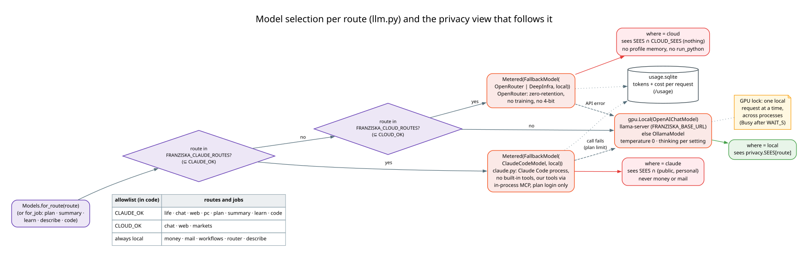
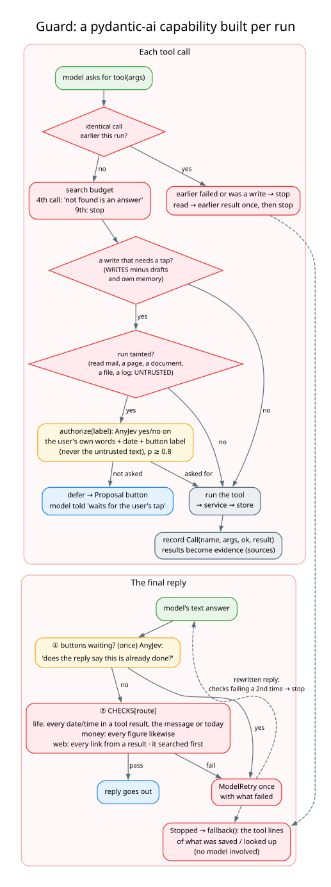

# Models, the GPU, and the guard around every run

← [Architecture guide](../ARCHITECTURE.md)

This page covers how a model is chosen and reached (`llm.py`, `gpu.py`, `claude.py`, `cloud.py`, `pi/think.ts`,
`jev_server.py`), how its context is kept within the window (`budget.py`), and how every agent run is checked
(`guards.py`).

## 1. The local model

One model serves everything: agents, router decisions, extractions, summaries, the coding loop.

```
llama-server -m gemma-4-26B-A4B-it-UD-Q4_K_M.gguf --host 127.0.0.1 --port 8080 \
  -c 32768 -np 1 -fa on -ctk q8_0 -ctv q8_0 --jinja --fit on --temp 1.0 --top-k 64 --top-p 0.95
```

| flag | why |
|---|---|
| gemma-4-26B-A4B, Q4_K_M | a mixture-of-experts model: 26B parameters, ~4B active per token. It won the mail-agent sweep against the 12B (18/21 multi-step tasks vs 4/7), and runs at ~38 tok/s |
| `--fit on` | places the experts that don't fit in the RTX 3060's 12 GB in system RAM (~10.7 GB VRAM used) |
| `-c 32768 -np 1` | one 32k-token context, one request at a time. `Budget` scales every size limit to the real `n_ctx` the server reports at `/props` |
| `-ctk/-ctv q8_0`, `-fa on` | quantised KV cache with flash attention, so 32k fits |
| `--jinja` | the model's own chat template, which reads `enable_thinking` per request (`FRANZISKA_THINKING`) |
| sampling flags | Gemma's recommended values; the bot's agents send temperature 0 per request anyway |

The same server answers two kinds of request:

- **`/v1/chat/completions`** (OpenAI-compatible): Pydantic AI's `OpenAIChatModel` for agents, extractions and
  summaries. Typed outputs use `NativeOutput`, which sends the JSON schema as `response_format`, and llama-server
  turns it into a grammar, so the output always parses.
- **`/completion`** (raw): AnyJev sends token ids and reads `n_probs=50` logprobs for one token
  (`jev_server.py`). Because the router uses the same server, routing never loads a second model.

Without `FRANZISKA_BASE_URL`, everything falls back to Ollama (`OllamaModel`, `jev_ollama.py` with top-20 logprobs).
Model measurements and the settings that were tried are in `MODEL_NOTES.md`, `MODEL_FINDINGS.md` and
`LLAMA_SETTINGS.md`.

### The GPU lock

`gpu.py` holds a **cross-process file lock** (`$XDG_RUNTIME_DIR/franziska-gpu.lock`) around every local request:

- `gpu.Local` wraps the Pydantic AI model, so every agent or extraction request takes the lock.
- AnyJev decisions take it in the backend.
- `use(owner)` waits up to `WAIT_S` (180 s) and then raises `Busy`, which the core turns into "⏳ busy, try again".
- `hold(owner)` is for long jobs (an eval run, a model sweep): requests from *other* processes fail at once with
  `Busy` naming the job, instead of queueing for hours.

Why: on a 12 GB card, two local jobs at once either fail to load or spill to RAM. Cloud and Claude models never take
the lock and run in parallel. The bot, the web UI and a coding job's loop interleave request by request.

## 2. Choosing the model per route



`llm.Models.for_route(route)` is the only place that picks a model. Agents, workflows, scheduled jobs and CLIs all
ask it.

1. **Claude** if `FRANZISKA_CLAUDE_MODEL` is set and the route is in `FRANZISKA_CLAUDE_ROUTES`. The list must be a
   subset of `CLAUDE_OK` = life, chat, web, pc and the jobs plan, summary, learn, code.
2. **The cloud model** if `FRANZISKA_CLOUD_MODEL` is set and the route is in `FRANZISKA_CLOUD_ROUTES`. The list must
   be a subset of `CLOUD_OK` = chat, web, markets.
3. **The local model** otherwise. Money, mail, the workflows, the router and document cards are always local.

A route outside the allowlist **refuses to start** (a `ValueError` at startup), so a typo in `.env` can't send
money to the cloud. Claude and cloud models are wrapped as `Metered(FallbackModel(remote, local))`:

- `FallbackModel` answers with the local model when the remote call fails (no credit, plan limit, outage);
- `Metered` writes each request's tokens and billed cost to `usage.sqlite` (`/usage`), never the text.

`Models.where(model)` says `local`, `claude` or `cloud`, and that decides what the run may see
(`privacy.where_sees`). `for_job(job, routes)` puts a background job on Claude only when the job *and every route
whose data it reads* are allowed there. A fold of money's turns never leaves the machine.

### Claude through your subscription (`claude.py`)

A Pydantic AI `Model` backed by the **Claude Agent SDK**, signed in with Claude Code's own login (your plan's
limits, no API key). The design keeps Franziska's agents, guards, buttons and privacy views as the harness and
swaps only the model:

- one Claude Code process per agent run, with **no built-in tools** (`tools=[]`), no settings files, hooks,
  CLAUDE.md or MCP servers except one in-process server, and `--no-session-persistence` (nothing written to
  `~/.claude/projects`);
- the run's tools are served through that in-process MCP server. When Claude calls one, the call is **held open**
  and returned to Pydantic AI as an ordinary tool call. Pydantic AI runs it (through the guard) and its next request
  carries the result, which releases the held call (paired by Claude Code's `claudecode/toolUseId`);
- API-key variables are blanked for the child process, and a run whose init frame reports an API key source is
  refused. Billing is the subscription only.

### The cloud model (`FRANZISKA_CLOUD_MODEL`)

`openrouter:<id>` or `deepinfra:<id>`, through Pydantic AI's OpenRouter / OpenAI providers. OpenRouter requests are
restricted to zero-retention endpoints that don't train on prompts, support every parameter sent, and aren't 4-bit
quantised (`OPENROUTER_PROVIDER`). A cloud chat or web turn gets **no profile memory** and no `run_python`.

### ChatGPT through pi (`/think`, desktop-off turns)

`cloud.py` runs `node pi/think.ts` with the prompt on stdin. `think.ts` creates an **in-memory pi session** with the
user's ChatGPT login (`pi` → `/login openai`). Its only tools are the `life` MCP server's (schedule, calendar,
notes), with no shell, no files and no user skills or context files. Times are plain strings in the MCP schema,
because pi validates arguments against JSON Schema and would reject local times as `date-time`.

## 3. The context budget (`budget.py`)

The window is one budget, and every size limit is a share of it (the reference is 32k). With a bigger model, they
grow without a code change:

| limit | at 32k |
|---|---|
| history turns kept per chat and route | 6 (4–24) |
| one attachment page | 12 000 chars |
| one Gmail answer | 48 KB |
| fold older turns into the summary when the window passes | 60 % |
| the rolling summary | ≥ 600 tokens |
| tool results a run may keep | 45 % of the window |

`Budget.capability()` is a Pydantic AI `ProcessHistory` capability. Before every model request it shortens the
**oldest tool results** once the run's results exceed their share. The model's own words, the questions and the
tool calls stay, and the model can call a tool again. The same trim applies mid-run (a mail sweep that piles up
search results) and to the history kept for the next turn.

## 4. The guard (`guards.py`)



`guards.Guard` is a Pydantic AI **capability** built fresh for every run, with the user's text, "now", the route's
reply checks, the taint flag and three callbacks from the core: `defer` (turn a write into a proposal), `authorize`
(the `AUTHORIZE_Q` decision) and `claimed` (the `CLAIM_Q` decision). It hooks into every tool call and into the final
output.

### On each tool call

| check | rule | why |
|---|---|---|
| **loop** | an identical call that failed before, or a write that succeeded, stops the run; an identical read gets the earlier result once (with a note), then stops | a retry of a rejected call is rejected again; a duplicate write is a bug; stopping on the first repeated read killed runs that had their answer |
| **search budget** | from the 4th call of one search tool in a run, results say "not found is an answer"; the 9th stops | seven `gmail_search` calls for a flight that wasn't in the mailbox ran into the 300 s limit |
| **taint** | after a tool in `UNTRUSTED` (mail, Drive, web, documents, files, logs, `past_conversations`) the run is tainted | the content was written by someone else |
| **write after taint** | a tool in `WRITES` (minus drafts and the agent's own memory) becomes a **proposal** unless `authorize(label)` says your message asked for it (p ≥ 0.8) | an email saying "archive everything from the bank" can at most produce a button. `authorize` sees only your words, the date and the button label, never the untrusted text, so injected content can't approve its own action |
| **record** | every call is a `Call(name, args, ok, result)` | evidence for the reply check, the turn log's `tools`, and the fallback |

### On the final reply

1. **Claims** (once, only while buttons wait): one AnyJev yes/no per waiting button label. "Does the reply say this
   is already done?" If yes, the model is sent back once to say the item waits for the tap.
2. **`CHECKS[route]`**: `life` → `dates` (every date and time in the reply must appear in a tool result, your
   message or today), `money` → `figures` (every number likewise), `web` → `links` (every URL from a result) and
   `searched` (no reply before a search). A failing reply is sent back once with what failed, and a second failure
   stops the run.

The checks match facts with a fixed written form (dates, times, numbers, URLs). There are deliberately **no phrase
lists** for meaning (decision 35): "saved" / "done" claims are an AnyJev decision, not a regex.

### When the guard stops a run

`Stopped` is raised, and the reply is `Guard.fallback()`, built **without a model**:

- the result lines of what was written, if anything was;
- else the proposals waiting;
- else, for public search results, the results themselves;
- else "I looked with gmail_search ×3 ("volo vienna", …) and agenda. Nothing was changed."

So a stopped run can't invent anything, and it never dumps raw tool output (48 KB of mail JSON once reached the
user that way).

`guards.run_sync` gives the CLIs the same guard as the bot.
