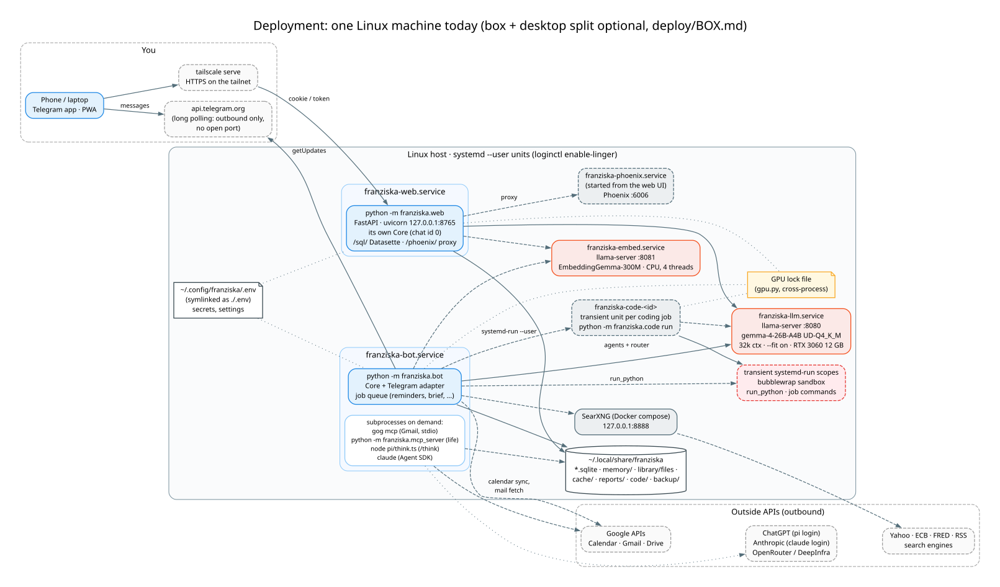
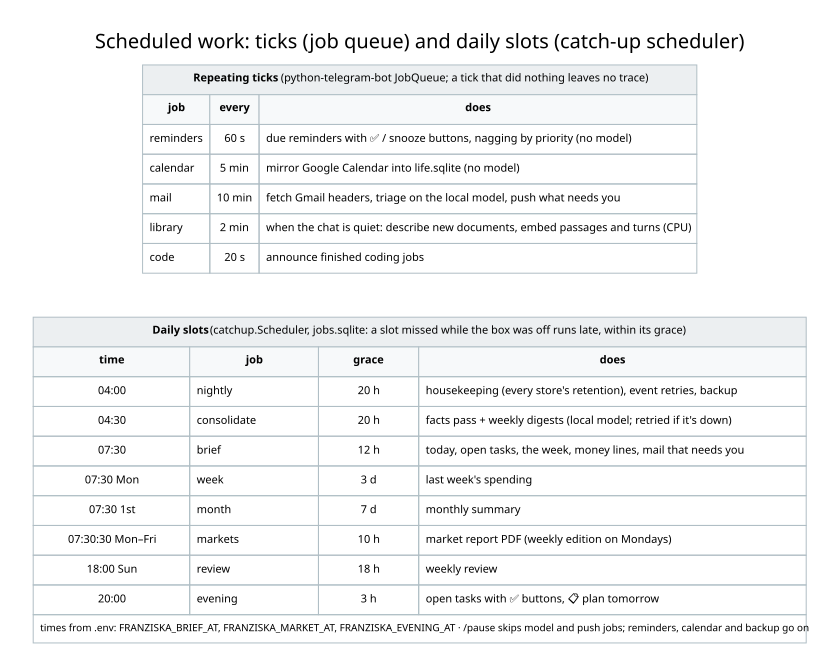
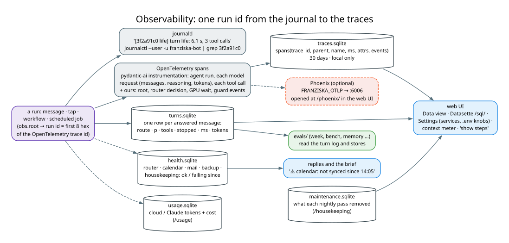

# Operations: deployment, jobs, observability, the web UI, configuration, evals

← [Architecture guide](../ARCHITECTURE.md) · day-to-day commands: [`COMMANDS.md`](../../COMMANDS.md)

## 1. Deployment

All long-running pieces are **systemd user units** (`deploy/*.service`), installed with
`cp deploy/*.service ~/.config/systemd/user/ && systemctl --user daemon-reload`. `loginctl enable-linger` lets them
start at boot without a login.

| unit | runs | notes |
|---|---|---|
| `franziska-llm` | `llama-server` gemma-4-26B-A4B, :8080 | the GPU; stopped by evals that need other models, started again after |
| `franziska-embed` | `llama-server --embedding` EmbeddingGemma-300M, :8081 | CPU only (`CUDA_VISIBLE_DEVICES=`), `Nice=10` |
| `franziska-bot` | `uv run --env-file .env python -m franziska.bot` | Telegram long polling and all jobs |
| `franziska-web` | `uv run --env-file .env python -m franziska.web` | :8765 on the loopback; `tailscale serve --bg 8765` for the tailnet |
| `franziska-phoenix` | `uvx arize-phoenix serve`, :6006 | not enabled; the web UI's Telemetry link starts it |
| `franziska-code-<id>` | `python -m franziska.code run <id>` | transient, one per coding job |
| SearXNG | `docker compose -f deploy/searxng/compose.yml up -d` | :8888 on the loopback |

Binaries outside Python: llama.cpp b11936 (CUDA 12.8) in `~/.local/opt/llama.cpp`, models in `~/models/gguf`,
`gog` v0.47.1 in `~/.local/bin`, Node 24 and pi under `pi/node_modules`, plus `bwrap`, `poppler-utils` and
`tesseract-ocr-ita` from apt. Release binaries were checked against their published checksums.

After a code change: `systemctl --user restart franziska-bot franziska-web`. Start only one bot: Telegram's long
polling allows a single consumer per token.

**Box + desktop** (`deploy/BOX.md`, optional): the bot, the stores and every model-free job move to a ~10 W box. The
model stays on the desktop, reached over Tailscale and woken with a Wake-on-LAN magic packet (`compute.Desktop`).
The router runs on the box from a tensor-free 16 MB GGUF (`python -m franziska.export_vocab`) plus the desktop's
logprobs.

## 2. Scheduled jobs

Two mechanisms, both in `bot.py`'s `main`:

- **Repeating ticks** on python-telegram-bot's JobQueue: reminders (60 s), calendar mirror (5 min), mail fetch and
  triage (10 min), library and turn embeddings (2 min, only when every chat has been quiet for 90 s and no turn
  runs), and announcing finished coding jobs (20 s). A tick that did nothing leaves no trace.
- **Daily slots** through `catchup.Scheduler`. PTB's `run_daily` fires only while the bot runs, so a brief due at
  07:30 would be lost if the machine woke at 09:00. Each job records the slot it served in `jobs.sqlite`. At start
  and every 5 minutes, missed slots run late **within a grace period** (the brief until the evening, the evening
  check-in for 3 hours). After a week off you don't get seven briefs. A job seen for the first time is marked done,
  not run.

`bot.unless_paused` skips the model and push jobs while `/pause` is on. The nightly job (04:00) runs
`housekeeping.run` (each store's retention: turn log, memory cache, handled events, 180-day mail rows, the document
cache's 90 days / 200 MB, report PDFs, 30-day sandbox artifacts, VACUUM when a file is 25 % free pages), retries
pending events, and writes the backup. Every pass is logged in `maintenance.sqlite` (`/housekeeping`). A failed
backup is pushed to you on Telegram.

## 3. Observability

Every message, tap, workflow and scheduled job is one **run** with one id: the first 8 hex digits of its
OpenTelemetry trace id (`obs.root`).

- **The journal** tells the story in a couple of lines per run, each prefixed `[3f2a91c0 life]` (run id, area).
  `journalctl --user -u franziska-bot | grep 3f2a91c0` shows one run. httpx's INFO lines are silenced because they
  carry the bot token in URLs.
- **`traces.sqlite`** holds everything inside the run as spans. Pydantic AI's own instrumentation gives the agent
  run, each model request (messages in and out, reasoning, tokens, finish reason) and each tool call (arguments,
  result). `obs.py` adds what Pydantic AI can't see: the root, the router's decision, the GPU-lock wait, the guards'
  rewrites and stops (span `events`), and event handlers. Kept 30 days, local only, never backed up (spans hold mail
  and money).
- **Phoenix** (optional): `FRANZISKA_OTLP=http://localhost:6006/v1/traces` sends the same spans over OTLP to a
  local Phoenix, opened at `/phoenix/` behind the web UI's sign-in.
- **`health.sqlite`**: components report `ok` / `failed` (router, calendar, mail, backup, housekeeping). While one is
  failing, the brief, `/today` and every reply that relied on it carry a line like
  "⚠️ calendar: not synced since 14:05". Nothing is retried or hidden there; failures are only made visible.
- **`usage.sqlite`**: tokens and billed cost of cloud and Claude requests, per route (`/usage`).
- **The turn log** (see [memory-and-library.md](memory-and-library.md#the-turn-log-turnspy)) is also what evals
  read.

Ready-made SQL for the traces is in `COMMANDS.md` ("Logs and traces").

## 4. The web UI (`franziska/web/`, `docs/WEB.md`)

A second adapter over its own `Core`, served by FastAPI and installed as a PWA on phone and desktop. Telegram stays
the place for pushes and quick capture. The web UI is for what chat is bad at, and it keeps replies off Telegram's
servers.

| view | backed by |
|---|---|
| **Chat** | `POST /api/chat` streams NDJSON: `status` lines (routing, the assistant, a workflow's steps, wake-up), then one `reply` with text, buttons, files, steps and the context meter. Same routing, agents, guards and proposals as Telegram, as its own conversation (`chat_id 0`) |
| **Today** | `Life` directly: this week, open tasks, ✅ with undo |
| **Money** | `Money`: balances, month summary, budgets, charges, bills |
| **Memory** | memory files (🗑 each), the agents' **Rules** (edit an agent's instructions: `instructions.py`), reminder rules |
| **Workflows** | one form per workflow, generated from `/api/workflows` |
| **Data** | every store, read-only (`mode=ro`); **Datasette** at `/sql/` for SQL, facets and CSV |
| **Code** | coding jobs: start, diff, merge / change / discard |
| **Settings** | which units run, a whitelist of `.env` knobs (never secrets), llama-server unit drop-ins; nothing restarts by itself |
| **World** (`/world`) | a three.js landscape of the team, laid out from `/api/world` and animated by the chat stream |

The front end is vanilla ES modules with no build step (`static/app.js`, `flows.js`, `world/`), with a service
worker for the PWA. Access: without `FRANZISKA_WEB_TOKEN` only a browser on the machine gets in. With it,
`/login?token=…` sets a cookie once per device, and the UI is reached over `tailscale serve` HTTPS.

## 5. Configuration

One file, `~/.config/franziska/.env` (symlinked as `./.env`; template `.env.example`), read by `config.Settings`.
The groups:

| group | keys (prefix `FRANZISKA_`) |
|---|---|
| Telegram | `TELEGRAM_TOKEN`, `ALLOWED_IDS` |
| local model | `BASE_URL` (llama-server; empty → Ollama with `MODEL`), `THINKING`, `TIMEOUT_S`, `ROUTER`, `ROUTER_MIN_P`, `ROUTER_VOCAB` |
| schedule | `TIMEZONE`, `BRIEF_AT`, `EVENING_AT`, `BRIEF_MONEY`, `MARKET_AT`, `MARKET_LANG` |
| optional models | `CLAUDE_MODEL`, `CLAUDE_ROUTES`, `CLAUDE_EFFORT`; `CLOUD_MODEL`, `CLOUD_ROUTES`, `CLOUD_ZDR`, `CLOUD_REASONING`; `PI_MODEL` |
| privacy | `SEES` (override the privacy table) |
| box mode | `OLLAMA_BASE_URL`, `DESKTOP_MAC`, `DESKTOP_BROADCAST`, `WHEN_OFF`, `WAKE_TIMEOUT_S` |
| Google | `GOOGLE`, `GOOGLE_CALENDAR`, `MAIL_EVERY_MIN`; `GOG_ACCOUNT`, `MAIL_MODEL`, `MAIL_BASE_URL`, `MAIL_THINKING`, `MAIL_REASONING` |
| web | `WEB_HOST`, `WEB_PORT`, `WEB_TOKEN`, `SEARXNG_URL` |
| documents | `EMBED_URL`, `RERANK_URL`, `VOICE_MODEL`, `VOICE_DEVICE` |
| code | `SANDBOX_VENV`, `SANDBOX_TIMEOUT_S`, `CODE_REPOS`, `CODE_MINUTES`, `CODE_STEPS`, `CODE_THINKING`, `PC`, `PC_FOLDERS` |
| storage | `DATA_DIR`, `BACKUP_DIR`, `BACKUP_KEEP`, `OTLP` |

Allowlists that matter for safety are **in code, not in `.env`**: `llm.CLOUD_OK`, `llm.CLAUDE_OK`,
`delegation.ASK`, `guards.WRITES` / `UNTRUSTED`, `privacy.SEES`. A new route is local and private until someone adds
it on purpose.

## 6. Evals and tests

**Tests** (`tests/`, `uv run pytest`) are few and end-to-end on purpose (CLAUDE.md): the real bot and core on
scripted models (Pydantic AI's `FunctionModel`, AnyJev's fake backend) and a fake Google, covering
Telegram → router → agent → stores → jobs → buttons. `pytest -m ollama` and `-m week` opt into the live model.

**Evals** (`evals/`, `evals/README.md`) come in two kinds:

- **The bot itself**: `week` (a simulated week on the real local model, ~10–15 min), `memory`, `library`,
  `sandbox`. These use the real router, agents and guards,
  judged on the stores afterwards. `evals.week --claude sonnet` / `--cloud openrouter:<id>` compares models on the
  same harness with synthetic data.
- **Model comparison**: `bench` (tasks by tier: easy, medium, agent, multi, hard), `mail_eval` (the real mail agent
  against a fake Gmail with gog's schemas, `fake_gog.py`), `router_eval` and the speed sweeps. They are driven by
  `funnel` (cheap stages first) and `campaign` (planned series). Every row carries the harness version, task
  version, serving config and budget, so `evals.plan` compares only like with like.

Rules every eval follows: one model on the GPU at a time (`franziska-llm` stopped, `gpu.hold` taken), resumable
row by row, bounded by timeouts and a watchdog, and reported as **signal, not verdict**. Write-ups go in
`evals/reports/<date>/`.
